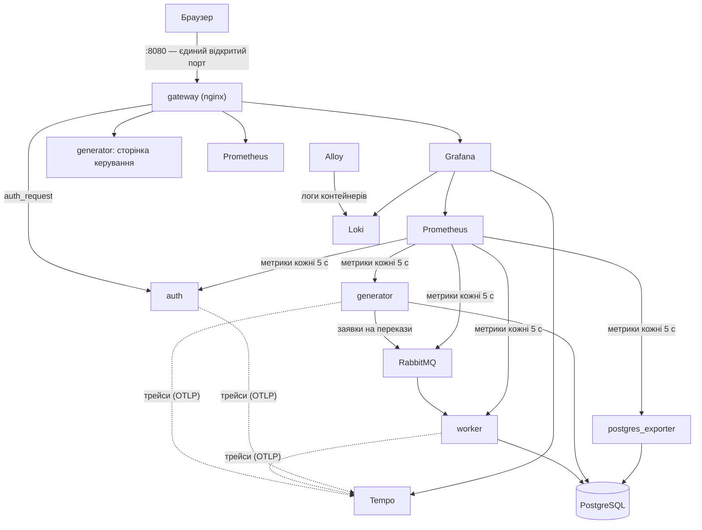

# BankMonitor

> Виконав Шевнюк Михайло, група ПІ-41. Тут лежить копія проєкту для здачі; повна історія розробки — в окремому репозиторії [BloodsFa1zer/bank-monitor](https://github.com/BloodsFa1zer/bank-monitor). Запускати можна й звідси: `cd semester_7/IC && make up`.

Навчальна система моніторингу роботи СУБД на прикладі банківських переказів. Генератор на Python імітує клієнтів банку й надсилає заявки на перекази через чергу RabbitMQ; обробник виконує кожен переказ однією транзакцією в PostgreSQL. Prometheus збирає метрики бази, черги й сервісів і зберігає їх у своїй базі часових рядів, Loki — логи всіх контейнерів, Tempo — трейси кожної операції, а Grafana показує все разом і дає переходити від графіка до логу й трейсу. Потрапити в систему можна лише після входу через власний сервер авторизації (FastAPI + SQLite, JWT). Усе запускається в Docker однією командою, а на сторінці керування можна ввімкнути аномалії — повільні запити, конкуренцію за блокування, взаємні блокування, масові відмови — і подивитися, як їх видно в метриках, логах і трейсах.

**Звіт:** [docs/REPORT.md](docs/REPORT.md), PDF — [docs/Звіт_BankMonitor_Шевнюк.pdf](docs/Звіт_BankMonitor_Шевнюк.pdf). **Інструкція для самостійної перевірки:** [docs/HOW-TO-TEST.md](docs/HOW-TO-TEST.md).

## Архітектура



| Контейнер | Що робить |
|---|---|
| `postgres` | PostgreSQL 17: 200 рахунків, перекази, журнал проводок |
| `rabbitmq` | черга заявок на перекази між генератором і worker |
| `worker` | бере заявки з черги, виконує переказ однією транзакцією |
| `generator` | створює навантаження, перемикає сценарії, SQL-зонд стану бази, сторінка керування |
| `auth` | вхід за логіном і паролем, JWT, перевірка доступу для gateway |
| `gateway` | nginx: єдиний вхід, пускає далі лише після перевірки в `auth` |
| `postgres-exporter` | метрики PostgreSQL для Prometheus |
| `prometheus` | збирає метрики, зберігає їх 15 діб, обчислює 7 правил алертів |
| `grafana` | 6 дашбордів, переходи між метриками, логами й трейсами |
| `grafana-init` | одноразово робить «BankMonitor — огляд» домашнім дашбордом |
| `loki` | сховище логів |
| `alloy` | збирає логи всіх контейнерів проєкту й надсилає в Loki |
| `tempo` | сховище трейсів |

## Що потрібно

- Docker Desktop (або Docker Engine) з Compose v2; для контейнерів — щонайменше 6 ГБ памʼяті (сам стенд займає ≈1,5 ГБ, решта — запас на збірку й тести).
- `make` і `git`.
- Вільний порт 8080. Якщо він зайнятий, задайте інший у `.env`: `GATEWAY_PORT=8081`.

Python на машині не потрібен: тести й лінтер працюють у контейнері.

## Швидкий старт

```bash
git clone https://github.com/BloodsFa1zer/bank-monitor.git
cd bank-monitor
make up
```

Перший запуск завантажує образи й збирає сервіси (кілька хвилин), наступні — ≈1 хвилина. `make up` повертається, коли всі сервіси готові. Далі відкрийте <http://localhost:8080> — зʼявиться форма входу.

## Облікові записи

Значення беруться з `.env`, який `make` створює з `.env.example` під час першого запуску.

| Логін | Пароль | Роль | Що доступно |
|---|---|---|---|
| `admin` | `admin12345` | admin | дашборди Grafana (роль Admin), Prometheus, сторінка керування навантаженням |
| `viewer` | `viewer12345` | viewer | лише дашборди Grafana (роль Viewer) |

Паролі навчальні — для будь-чого, крім демонстрації, змініть їх у `.env`.

## Адреси

Усі адреси — через gateway на <http://localhost:8080>.

| Шлях | Що там | Хто має доступ |
|---|---|---|
| `/` | перенаправлення на `/grafana/` | — |
| `/auth/login`, `/auth/logout` | вхід і вихід | усі |
| `/grafana/` | Grafana, домашній дашборд «BankMonitor — огляд» | admin, viewer |
| `/prometheus/` | Prometheus: цілі (`/prometheus/targets`), алерти (`/prometheus/alerts`), запити | admin |
| `/control/` | сторінка керування навантаженням і сценаріями | admin |

Дашборди Grafana (тека «BankMonitor»):

| Дашборд | Адреса |
|---|---|
| BankMonitor — огляд | `/grafana/d/bank-overview` |
| PostgreSQL | `/grafana/d/bank-db` |
| Застосунок: перекази | `/grafana/d/bank-app` |
| RabbitMQ | `/grafana/d/bank-queue` |
| Логи | `/grafana/d/bank-logs` |
| Трейси | `/grafana/d/bank-traces` |

## Сценарії

| Сценарій | Що відбувається | Алерти | Де дивитися |
|---|---|---|---|
| `normal` — звичайний режим | перекази між усіма рахунками на суми до 500 | немає | огляд |
| `slow_queries` — повільні запити | кожна транзакція переказу триває щонайменше 0,8 с, черга росте | TransferProcessingSlow, QueueBacklog | огляд, «RabbitMQ», трейси повільних переказів |
| `lock_contention` — конкуренція за блокування | усі перекази між трьома рахунками, транзакції чекають на блокування рядків | LockWaiters, TransferProcessingSlow | «PostgreSQL», лог postgres («still waiting for») |
| `deadlocks` — взаємні блокування | зустрічні перекази блокують рахунки в різному порядку, PostgreSQL перериває одну транзакцію, worker повторює | DeadlocksDetected | «PostgreSQL», лог postgres («deadlock detected»), трейси з повторами |
| `failures` — масові відмови | половина переказів на 1 000 000, коштів бракує, транзакції відкочуються | TransferFailureRatioHigh | «Застосунок: перекази», логи `transfer_failed` |

Увімкнути сценарій:

- на сторінці <http://localhost:8080/control/> (вхід як `admin`): кнопка сценарію, поле «Автоповернення через, с» (типово 120 с);
- з терміналу: `make scenario NAME=deadlocks TTL=120` (без `TTL` сценарій діє, доки його не змінять; `make scenario NAME=normal` — повернутися).

## Команди

| Команда | Що робить |
|---|---|
| `make` | перелік команд |
| `make up` | зібрати й запустити стенд (назовні лише gateway) |
| `make up-dev` | те саме, плюс порти сервісів на `127.0.0.1` |
| `make down` | зупинити, дані зберегти |
| `make clean` | зупинити й видалити всі дані |
| `make ps`, `make logs S=worker` | стан контейнерів, логи сервісу |
| `make scenario NAME=<сценарій> [TTL=<с>]` | увімкнути сценарій |
| `make lint`, `make fmt` | перевірка й форматування коду |
| `make unit` | юніт-тести |
| `make e2e [K=<вираз>]` | наскрізні тести на запущеному стенді |
| `make outage-test` | тест зупинки worker |
| `make check-ports` | перевірити, що назовні опубліковано лише gateway |
| `make verify` | повна перевірка з нуля, ≈30 хв; останній рядок — `VERIFY OK` |

## Тестування

| Рівень | Що перевіряє | Команда |
|---|---|---|
| Статика | стиль коду й типові помилки (ruff) | `make lint` |
| Юніт | чисту логіку без стенда: повідомлення, порядок блокувань, сценарії, стан генератора, JWT, паролі, логи, трейсинг | `make unit` |
| Наскрізні | живий стенд зсередини мережі Docker: БД, черга, метрики, алерти, логи, трейси, доступ | `make e2e` |
| Збій | зупинка й запуск worker: черга росте, алерти спрацьовують, після запуску нічого не втрачено | `make outage-test` |
| Повний прогін | усе вище з чистого стану | `make verify` |

Один тест: `make e2e K=s05_ac7`. Тести зі сценаріями позначені `slow` і тривають хвилинами.

## Структура репозиторію

```
bank-monitor/
├── docker-compose.yml          стенд (назовні лише gateway)
├── docker-compose.dev.yml      порти сервісів на 127.0.0.1
├── Makefile, .env.example, pyproject.toml
├── db/init/                    схема, початкові дані, ролі PostgreSQL
├── services/
│   ├── common/                 спільний пакет: налаштування, JSON-логи, метрики, черга, трейсинг
│   ├── worker/                 обробник переказів
│   ├── generator/              генератор навантаження, сценарії, сторінка керування
│   └── auth/                   сервер авторизації
├── gateway/nginx.conf          єдиний вхід
├── observability/              Prometheus (правила алертів), Grafana (дашборди), Loki, Alloy, Tempo
├── tests/                      unit, e2e, outage
├── scripts/                    перевірки образів, портів, логів; сценарії; verify.sh
└── docs/                       план, журнал робіт, звіт, сценарій показу, скриншоти
```

## Режим розробки

`make up-dev` публікує порти сервісів лише на `127.0.0.1`, щоб дивитися на них напряму:

| Сервіс | Адреса |
|---|---|
| PostgreSQL | `127.0.0.1:15432` (5432 часто зайнятий локальним PostgreSQL) |
| RabbitMQ, інтерфейс керування | <http://127.0.0.1:15672> |
| worker, метрики | <http://127.0.0.1:8001/metrics> |
| generator, сторінка керування без входу | <http://127.0.0.1:8002/control/> |
| auth | <http://127.0.0.1:8003> |
| postgres_exporter | <http://127.0.0.1:9187/metrics> |
| Prometheus | <http://127.0.0.1:9090> |
| Grafana (вхід лише через gateway) | <http://127.0.0.1:3000> |
| Loki | <http://127.0.0.1:3100> |
| Alloy | <http://127.0.0.1:12345> |
| Tempo | <http://127.0.0.1:3200> |

Повернутися до звичайного режиму: `make down && make up`.

## Усунення проблем

| Симптом | Що робити |
|---|---|
| `make up` пише, що порт 8080 зайнятий | у `.env` задати `GATEWAY_PORT=8081` і відкривати <http://localhost:8081> |
| контейнер зупиняється з кодом 137 | Docker бракує памʼяті: у налаштуваннях Docker Desktop дати ≥ 6 ГБ |
| зміни в `db/init` не застосувались | скрипти ініціалізації виконуються лише на порожній базі: `make clean && make up` (дані стенда буде скинуто) |
| `make up` не дочекався готовності | `make ps` — хто не `healthy`; `make logs S=<сервіс>` — чому |
| змінили конфіг nginx, Prometheus, Grafana, Loki чи Tempo | ці сервіси читають конфіг на старті: `docker compose restart <сервіс>` |
| на дашборді «Логи» або «Трейси» порожньо одразу після старту | Alloy знаходить нові контейнери протягом 10 с, Tempo приймає трейси за кілька секунд — оновіть сторінку |
| стенд «дивно» поводиться | `make clean && make up` |
