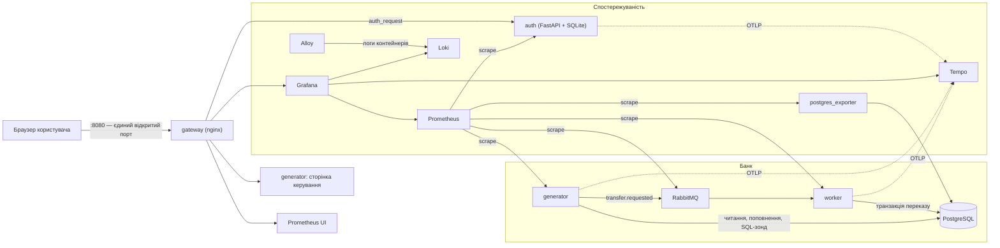

# BankMonitor — спільна частина плану

Система моніторингу роботи СУБД на прикладі банківських переказів: генератор створює навантаження на PostgreSQL через чергу RabbitMQ, Prometheus збирає метрики, Loki — логи, Tempo — трейси, Grafana все показує, а потрапити в систему можна лише через власний сервер авторизації.

Цей документ варто перечитувати **повністю перед кожним етапом**. Він описує продукт, архітектуру, контракт між компонентами та правила роботи. Конкретні етапи — у файлах `10-app.md`, `20-observability.md`, `30-release.md`.

## 0. Карта документів

| Файл | Що в ньому |
|---|---|
| `docs/00-common.md` | продукт, архітектура, версії, **контракт** (§6), правила (§5), тестування (§7), граблі (§8) |
| `docs/10-app.md` | етапи S0–S4: каркас, PostgreSQL, worker і RabbitMQ, generator, auth і gateway |
| `docs/20-observability.md` | етапи S5–S8: Prometheus, Grafana, Loki, Tempo |
| `docs/30-release.md` | етапи S9–S10: наскрізні сценарії, здача |
| `docs/progress.md` | журнал виконання етапів |

**Ідентифікатори.** Етапи: `S0…S10`. Критерії приймання: `S3-AC5` (етап S3, критерій 5). Правила: `R1…R14`. Граблі: `G1…G24`.

**Шаблон етапу** (однаковий в усіх файлах):

- **Мета** — що має запрацювати.
- **Залежить від** — які етапи мають бути завершені і як це перевірити.
- **Файли** — що створити або змінити. Це білий список: інших файлів етап не чіпає.
- **Вимоги** — нумерований перелік того, що реалізувати.
- **Поза межами етапу** — чого НЕ робити зараз.
- **Acceptance criteria** — перевірювані твердження з ID.
- **Перевірка** — команди, які треба виконати.
- **Ручна перевірка** — що перевірити руками в браузері.

## 1. Продукт

### 1.1 Що це

Навчальний стенд із трьох частин:

1. **Банк.** 200 рахунків у PostgreSQL. Сервіс `generator` імітує клієнтів: надсилає заявки на перекази в чергу, перевіряє баланси, читає виписки, поповнює рахунки. Сервіс `worker` забирає заявки з черги й виконує кожен переказ однією транзакцією.
2. **Спостережуваність.** Метрики БД, черги й сервісів — у Prometheus; логи всіх контейнерів — у Loki; трейси кожної операції — у Tempo; дашборди та переходи «метрика → лог → трейс» — у Grafana.
3. **Доступ.** Назовні відкрито один порт (`gateway`). Усе за ним доступне лише після входу через сервіс `auth` (логін, пароль, JWT, ролі `admin` і `viewer`).

Щоб було що досліджувати, генератор уміє вмикати **сценарії аномалій** (§6.6): повільні запити, конкуренцію за блокування, взаємні блокування (deadlock), масові відмови. Кожна аномалія залишає слід у всіх трьох сигналах.

### 1.2 Покриття завдання

| № | Вимога завдання | Чим закривається | Етапи |
|---|---|---|---|
| 0 | СУБД у Docker-контейнері | PostgreSQL 17 у compose, схема й сід через init-скрипти | S1 |
| 1 | Генерація актуалізації даних (Python) | `generator` + `worker`: INSERT, UPDATE, SELECT у транзакціях | S2, S3 |
| 2 | Збір даних Prometheus | `postgres_exporter`, `/metrics` сервісів, плагін RabbitMQ, власний SQL-зонд | S5 |
| 3 | Time Series Storage | вбудована TSDB Prometheus на volume, retention 15 діб | S5 |
| 4 | Відображення в Grafana | 6 дашбордів, provisioning як код | S6–S8 |
| 5 | Дослідження логів, Loki | Alloy збирає логи контейнерів; JSON-логи сервісів; лог повільних запитів і блокувань PostgreSQL | S7 |
| 6 | Дослідження трейсів, Tempo | OpenTelemetry: один трейс `generator → RabbitMQ → worker → SQL` | S8 |
| 7 | Авторизація (Python + SQLite) | `auth`: FastAPI, SQLite, bcrypt, JWT; nginx `auth_request` | S4 |
| 8 | Контейнеризація Docker | один `docker-compose.yml`, запуск `make up` | S0–S8 |
| 9 | Обмін повідомленнями | RabbitMQ між `generator` і `worker`, DLQ | S2 |

### 1.3 Що входить

- 12 контейнерів в одному compose-проєкті, запуск однією командою.
- 5 сценаріїв навантаження з веб-сторінкою керування.
- 7 правил алертів Prometheus.
- 6 дашбордів Grafana з переходами між метриками, логами й трейсами.
- Автоматичні тести: юніт і наскрізні (e2e), одна команда `make verify`.
- README, звіт і сценарій показу українською.

### 1.4 Що свідомо НЕ робимо

Alertmanager і надсилання сповіщень, HTTPS/TLS, Kubernetes, CI/CD, реплікація й HA, OAuth/OIDC, реєстрація користувачів і зміна пароля через UI, ORM і міграції, async-драйвери БД, фронтенд-фреймворки, Kafka, Tempo metrics-generator і service graph, алерти Grafana та Loki ruler, pgbench, мультитенантність. Якщо чогось немає в плані — цього не робимо.

## 2. Архітектура



**Шлях одного переказу** (його й треба розповідати на захисті):

1. `generator` обирає два рахунки та суму, відкриває спан `generator.transfer` і публікує повідомлення `transfer.requested`.
2. RabbitMQ тримає повідомлення в черзі `transfers.requested`, доки його не забере один із потоків `worker`.
3. `worker` в одній транзакції блокує обидва рахунки (`SELECT … FOR NO KEY UPDATE`), записує переказ, списує, зараховує, додає два записи в журнал проводок. Невдача (брак коштів) відкочує транзакцію, і переказ записується як `failed`.
4. `postgres_exporter` і SQL-зонд бачать наслідки в статистиці БД; `worker` збільшує свої лічильники; PostgreSQL пише в лог повільні запити, очікування блокувань і помилки.
5. Трейс переказу проходить `generator → publish → consume → worker → SQL`; рядок логу `worker` містить той самий `trace_id`.

**Модель безпеки.** Межа довіри — мережа compose. Назовні опубліковано лише `gateway`. Він щоразу питає `auth`, чи дійсний токен, і тільки тоді проксіює запит далі; заголовки з іменем користувача формує сам, клієнтські відкидає. Сервіси всередині мережі одне одному довіряють. Режим розробки (`docker-compose.dev.yml`) додатково відкриває порти на `127.0.0.1` — тільки для налагодження.

## 3. Стек і версії

Теги образів перевірено на Docker Hub 2026-11-12: усі існують. Разом на стенді вони ще не запускались — це робить етап S0 (`S0-AC5`) і кожен наступний етап. Не змінювати (R3).

| Компонент | Образ | Примітка |
|---|---|---|
| PostgreSQL | `postgres:17.11` | свідомо 17, а не 18: у 18 змінено розташування даних в образі |
| RabbitMQ | `rabbitmq:4.3.7-management` | плагіни management і prometheus увімкнені в образі |
| Prometheus | `prom/prometheus:v3.15.1` | |
| postgres_exporter | `prometheuscommunity/postgres-exporter:v0.20.1` | |
| Grafana | `grafana/grafana:13.2.6` | |
| Loki | `grafana/loki:3.6.20` | один процес, файлове сховище |
| Alloy | `grafana/alloy:v1.21.3` | замість Promtail, який знято з підтримки |
| Tempo | `grafana/tempo:2.10.10` | свідомо 2.x: у 3.x інша архітектура; один процес, локальне сховище |
| nginx | `nginx:1.30.6-alpine` | стабільна гілка, модуль `auth_request` є в образі |
| Python | `python:3.13.18-slim` | база для `generator`, `worker`, `auth`, `tests` |

**Python-залежності** — тільки з цього списку (R3). Точні версії обирає етап, який уперше додає пакет: найновіша стабільна на момент виконання, записана через `==`.

| Де | Пакети |
|---|---|
| `common` | `prometheus-client` |
| `worker` | `psycopg[binary]`, `pika` |
| `generator` | `psycopg[binary]`, `pika`, `fastapi`, `uvicorn` |
| `auth` | `fastapi`, `uvicorn`, `python-multipart`, `bcrypt`, `PyJWT` |
| трейсинг (з S8) | `opentelemetry-sdk`, `opentelemetry-exporter-otlp-proto-grpc`, `opentelemetry-instrumentation-psycopg`, `opentelemetry-instrumentation-pika`, `opentelemetry-instrumentation-fastapi` |
| `tests` | усе вище плюс `pytest`, `requests`, `httpx`, `ruff` |

**Де звіряти синтаксис конфігів** (R4). Перше джерело правди — сам бінарник зафіксованої версії: `--help`, вбудована перевірка конфіга, фактичний запуск. Друге — документація саме цієї версії:

| Компонент | Документація | Перевірка конфіга |
|---|---|---|
| Prometheus | `prometheus.io/docs/prometheus/latest/` | `promtool check config`, `promtool check rules` |
| Grafana | `grafana.com/docs/grafana/v13.2/` | запуск + `/api/health`, логи provisioning |
| Loki | `grafana.com/docs/loki/v3.6.x/` | `loki -verify-config` |
| Alloy | `grafana.com/docs/alloy/v1.21/` | `alloy fmt`, запуск + `/-/ready` |
| Tempo | `grafana.com/docs/tempo/v2.10.x/` | запуск + `/ready` |
| nginx | `nginx.org/en/docs/` | `nginx -t` |
| postgres_exporter | README репозиторію `prometheus-community/postgres_exporter` тегу `v0.20.1` | `--help`, `curl /metrics` |

## 4. Структура репозиторію

```
bank-monitor/
├── README.md
├── Makefile
├── pyproject.toml                  # ruff + pytest
├── .env.example                    # .env створюється з нього автоматично
├── docker-compose.yml              # базовий режим: назовні тільки gateway
├── docker-compose.dev.yml          # режим розробки: порти на 127.0.0.1
├── db/init/                        # 01-schema.sql, 02-seed.sql, 03-roles.sh
├── services/
│   ├── common/                     # пакет bankmon_common
│   │   ├── pyproject.toml
│   │   └── bankmon_common/         # config, logging, metrics, db, amqp, messages, tracing
│   ├── worker/                     # Dockerfile, requirements.txt, bank_worker/
│   ├── generator/                  # Dockerfile, requirements.txt, bank_generator/
│   └── auth/                       # Dockerfile, requirements.txt, bank_auth/
├── gateway/nginx.conf
├── observability/
│   ├── prometheus/                 # prometheus.yml, rules/bank.yml
│   ├── grafana/                    # provisioning/{datasources,dashboards}/, dashboards/*.json
│   ├── loki/loki.yml
│   ├── alloy/config.alloy
│   └── tempo/tempo.yml
├── tests/
│   ├── Dockerfile, requirements.txt
│   ├── unit/                       # без стенда
│   ├── e2e/                        # на живому стенді, зсередини мережі compose
│   └── outage/                     # дві фази тесту зупинки worker
├── scripts/                        # check_images.sh, check_ports.sh, check_json_logs.sh, scenario.sh, verify.sh
└── docs/                           # план, журнал, звіт, сценарій показу, скриншоти
```

Назви Python-пакетів різні (`bankmon_common`, `bank_worker`, `bank_generator`, `bank_auth`), щоб образ `tests` міг імпортувати їх усі одночасно. Контекст збірки сервісів — `./services`, Dockerfile — `<сервіс>/Dockerfile`: так у кожен образ потрапляє `common`.

## 5. Правила

- **R1. Рівно за планом.** Роби те, що у «Вимогах» етапу. «Поза межами етапу» — заборона, а не побажання. Корисну ідею поза планом запиши в журнал, не реалізуй.
- **R2. Контракт заморожений.** Назви сервісів, порти, маршрути, таблиці, повідомлення, метрики, події логів, атрибути спанів, змінні середовища, uid дашбордів — саме такі, як у §6. На них спираються наступні етапи й тести.
- **R3. Версії й залежності.** Образи з §3 не змінюються. Python-пакети — лише з дозволеного списку, з точними версіями. Потрібен інший пакет чи інша версія — це зупинка.
- **R4. Не вгадуй конфіги.** Перед тим як писати конфіг Prometheus, Grafana, Loki, Alloy, Tempo, nginx чи прапорці експортера, звір ключі з `--help` і документацією зафіксованої версії (§3). Після — доведи запуском. Ключ «із памʼяті» без перевірки — дефект.
- **R5. Доказ, а не припущення.** Кожен AC доводиться запуском: вивід команди, зелений тест, побачене в браузері. Тести й критерії не послаблюються заради зеленого результату.
- **R6. Секрети.** Паролі й ключі — лише в `.env` (у репозиторії тільки `.env.example` з навчальними значеннями). У коді, логах, трейсах і метриках паролів і токенів немає.
- **R7. Один вхід.** У `docker-compose.yml` секція `ports` є лише в `gateway`. Усі інші порти — тільки в `docker-compose.dev.yml` і тільки на `127.0.0.1`.
- **R8. Логи.** Власні сервіси пишуть у stdout по одному JSON-обʼєкту на рядок у форматі §6.11. Жодних `print`.
- **R9. Стійкість.** Сервіси переживають перезапуск `postgres`, `rabbitmq`, `tempo`, `loki` без ручного втручання: повторні спроби зʼєднання з паузою, що зростає від 1 до 10 с. Порядок запуску задається `depends_on` із `condition: service_healthy`.
- **R10. Простота.** Синхронний код, потоки замість asyncio (крім того, що вимагає FastAPI), без ORM, без власних фреймворків. Цей код студент пояснює на захисті.
- **R11. Мови.** Код, коментарі, логи, коміти — англійською. Тексти інтерфейсу, назви дашбордів і панелей, README, звіт — українською.
- **R12. Тести без фіксованих пауз.** Очікування — тільки опитуванням із таймаутом (`wait_until`). Кожен тест можна запускати повторно на живому стенді; тест прибирає за собою (повертає сценарій `normal`).
- **R13. Чисто після себе.** Наприкінці роботи над етапом: сценарій `normal`, усі контейнери стенда працюють або зупинені командою `make down`, тимчасових файлів немає.
- **R14. Git.** Гілка `stage/sN-<slug>` на кожен етап, малі логічні коміти, без `git add -A`, без `push`, `merge`, `rebase`.

## 6. Контракт

### 6.1 Сервіси й порти

Імʼя compose-проєкту — `bankmon`. Імʼя сервісу є його DNS-імʼям у мережі.

| Сервіс | Внутрішні порти | Що там | Порт у dev-режимі (`127.0.0.1`) | Зʼявляється |
|---|---|---|---|---|
| `postgres` | 5432 | SQL | 15432 (5432 часто зайнятий локальним PostgreSQL) | S1 |
| `rabbitmq` | 5672, 15672, 15692 | AMQP, UI та API керування, метрики | 15672 | S2 |
| `worker` | 8000 | `/metrics` | 8001 | S2 |
| `generator` | 8000 | `/control/*`, `/metrics`, `/healthz` | 8002 | S3 |
| `auth` | 8000 | `/auth/*`, `/metrics`, `/healthz` | 8003 | S4 |
| `gateway` | 8080 | єдиний вхід | `${GATEWAY_PORT:-8080}` (у базовому файлі) | S4 |
| `postgres-exporter` | 9187 | `/metrics` | 9187 | S5 |
| `prometheus` | 9090 | API та UI | 9090 | S5 |
| `grafana` | 3000 | UI та API | 3000 | S6 |
| `grafana-init` | — | одноразово робить `bank-overview` домашнім дашбордом і завершується | — | S6 |
| `loki` | 3100 | API | 3100 | S7 |
| `alloy` | 12345 | UI, `/metrics` | 12345 | S7 |
| `tempo` | 3200, 4317 | API, OTLP gRPC | 3200 | S8 |
| `tests` | — | pytest, профіль `test` | — | S0 |

Томи: `pg_data`, `rabbitmq_data`, `auth_data`, `prom_data`, `grafana_data`, `loki_data`, `tempo_data`, а з S9 — `tests_state` (стан тесту зупинки `worker` між його фазами).

### 6.2 Маршрути gateway

| Шлях | Куди | Доступ | Зʼявляється |
|---|---|---|---|
| `/healthz` | відповідає сам nginx: `200 ok` | усі | S4 |
| `/` | `302 → /grafana/` | усі | S4 |
| `/auth/login`, `/auth/logout`, `/auth/token`, `/auth/me` | `auth:8000` | усі | S4 |
| `/control/` | `generator:8000` | `admin` | S4 |
| `/prometheus/` | `prometheus:9090` (префікс зрізається) | `admin` | S5 |
| `/grafana/` | `grafana:3000` | `admin`, `viewer` | S6 |
| усе інше | `404` | — | S4 |

Поведінка без дійсного токена: сторінки → `302` на `/auth/login?rd=<початковий шлях>`; усе під `/control/api/` і `/prometheus/api/` → `401` із JSON `{"detail":"Not authenticated"}`. Недостатня роль → `403`. Шляхи `/auth/verify`, `/metrics`, `/healthz` сервісів через gateway недоступні.

Заголовки до сервісів формує gateway з відповіді `auth`: `X-Auth-User`, `X-Auth-Role`; для Grafana — `X-WEBAUTH-USER`, `X-WEBAUTH-ROLE`. Однойменні заголовки від клієнта і заголовок `Authorization` у бік Grafana відкидаються.

### 6.3 Змінні середовища

Повний вміст `.env.example` (значення навчальні):

```dotenv
# PostgreSQL
POSTGRES_DB=bank
POSTGRES_USER=bank_admin
POSTGRES_PASSWORD=admin_pass_change_me
APP_DB_USER=bank_app
APP_DB_PASSWORD=app_pass_change_me
MONITOR_DB_USER=bank_monitor
MONITOR_DB_PASSWORD=monitor_pass_change_me

# RabbitMQ
RABBITMQ_DEFAULT_USER=bank
RABBITMQ_DEFAULT_PASS=rabbit_pass_change_me

# Auth
AUTH_JWT_SECRET=dev_jwt_secret_change_me_min_32_chars
AUTH_TOKEN_TTL_S=3600
AUTH_ADMIN_USER=admin
AUTH_ADMIN_PASSWORD=admin12345
AUTH_VIEWER_USER=viewer
AUTH_VIEWER_PASSWORD=viewer12345

# Grafana (внутрішній адміністратор, тільки для provisioning і тестів)
GF_SECURITY_ADMIN_USER=grafana_admin
GF_SECURITY_ADMIN_PASSWORD=grafana_pass_change_me

# Навантаження
GEN_RATE=20
WORKER_CONCURRENCY=4

# Вхід
GATEWAY_PORT=8080
```

Змінні, які compose збирає для сервісів із цих значень:

| Змінна | Кому | Значення |
|---|---|---|
| `SERVICE_NAME` | усім Python-сервісам | `generator` / `worker` / `auth` |
| `LOG_LEVEL` | усім | `info` |
| `DATABASE_URL` | `worker`, `generator` | `postgresql://<APP_DB_USER>:<APP_DB_PASSWORD>@postgres:5432/<POSTGRES_DB>` |
| `MONITOR_DATABASE_URL` | `generator` | те саме з користувачем `MONITOR_DB_USER` |
| `AMQP_URL` | `worker`, `generator` | `amqp://<user>:<pass>@rabbitmq:5672/%2F` |
| `AUTH_DB_PATH` | `auth` | `/data/auth.db` |
| `OTEL_EXPORTER_OTLP_ENDPOINT` | усім Python-сервісам, з S8 | `http://tempo:4317` |

### 6.4 База даних

Схема `public` бази `bank`:

```sql
CREATE TABLE accounts (
  id          integer GENERATED ALWAYS AS IDENTITY PRIMARY KEY,
  owner_name  text NOT NULL,
  balance     numeric(14,2) NOT NULL CHECK (balance >= 0),
  created_at  timestamptz NOT NULL DEFAULT now(),
  updated_at  timestamptz NOT NULL DEFAULT now()
);

CREATE TABLE transfers (
  id            uuid PRIMARY KEY,
  from_account  integer NOT NULL REFERENCES accounts(id),
  to_account    integer NOT NULL REFERENCES accounts(id),
  amount        numeric(14,2) NOT NULL CHECK (amount > 0),
  status        text NOT NULL CHECK (status IN ('completed', 'failed')),
  fail_reason   text,
  attempts      smallint NOT NULL DEFAULT 1,
  requested_at  timestamptz NOT NULL,
  processed_at  timestamptz NOT NULL DEFAULT now(),
  CHECK (from_account <> to_account),
  CHECK ((status = 'failed') = (fail_reason IS NOT NULL))
);
CREATE INDEX transfers_from_idx ON transfers (from_account, processed_at DESC);
CREATE INDEX transfers_to_idx   ON transfers (to_account, processed_at DESC);

CREATE TABLE ledger_entries (
  id           bigint GENERATED ALWAYS AS IDENTITY PRIMARY KEY,
  account_id   integer NOT NULL REFERENCES accounts(id),
  transfer_id  uuid REFERENCES transfers(id),
  kind         text NOT NULL CHECK (kind IN ('opening', 'transfer_out', 'transfer_in', 'deposit')),
  delta        numeric(14,2) NOT NULL,
  created_at   timestamptz NOT NULL DEFAULT now()
);
CREATE INDEX ledger_account_idx ON ledger_entries (account_id, created_at DESC);

CREATE TABLE scenario_state (
  id           smallint PRIMARY KEY CHECK (id = 1),
  scenario     text NOT NULL,
  lock_order   text NOT NULL CHECK (lock_order IN ('sorted', 'naive')),
  lock_gap_ms  integer NOT NULL CHECK (lock_gap_ms >= 0),
  sleep_ms     integer NOT NULL CHECK (sleep_ms >= 0),
  updated_at   timestamptz NOT NULL DEFAULT now()
);
```

Значення `fail_reason`: `insufficient_funds`, `deadlock`.

**Сід.** 200 рахунків з `id` 1…200, `owner_name` = `Клієнт 001` … `Клієнт 200`, баланс `10000.00`; для кожного — запис журналу `opening` з `delta = 10000.00`. Один рядок `scenario_state`: `(1, 'normal', 'sorted', 0, 0)`.

**Ролі.**

| Роль | Хто | Права |
|---|---|---|
| `bank_admin` | власник, init-скрипти, тести | суперкористувач |
| `bank_app` | `worker`, `generator` | `SELECT`, `INSERT`, `UPDATE` на чотири таблиці; без `DELETE` і DDL |
| `bank_monitor` | `postgres_exporter`, SQL-зонд | членство в `pg_monitor`, `SELECT` на `accounts` |

**Налаштування сервера** (прапорцями `-c` у `command`): `shared_preload_libraries=pg_stat_statements`, `log_min_duration_statement=200`, `log_lock_waits=on`, `deadlock_timeout=500ms`, `track_io_timing=on`, `log_line_prefix='%m [%p] %u@%d '`. Розширення `pg_stat_statements` створене в базі `bank`.

**Інваріанти** (їх перевіряють тести після будь-якого навантаження):

- **I1.** Для кожного рахунку `balance = SUM(ledger_entries.delta)`.
- **I2.** `SUM(delta)` по записах `transfer_in` і `transfer_out` дорівнює 0.
- **I3.** Відʼємних балансів немає.
- **I4.** У переказу `completed` рівно два записи журналу (`transfer_out` з `-amount`, `transfer_in` з `+amount`), у `failed` — жодного.

### 6.5 RabbitMQ і повідомлення

| Обʼєкт | Параметри |
|---|---|
| exchange `bank.transfers` | `direct`, durable |
| queue `transfers.requested` | durable, аргумент `x-dead-letter-exchange = bank.dlx`, привʼязка за ключем `transfer.requested` |
| exchange `bank.dlx` | `fanout`, durable |
| queue `transfers.dead` | durable, привʼязана до `bank.dlx` |

Топологію ідемпотентно оголошують і `generator`, і `worker` під час кожного підключення однією спільною функцією з `bankmon_common.amqp`.

Повідомлення `TransferRequested`, версія 1:

```json
{
  "schema": 1,
  "transfer_id": "5b0c9a3e-8f0e-4c59-9c9b-2f3f0d6f1a11",
  "from_account": 17,
  "to_account": 142,
  "amount": "250.00",
  "requested_at": "2026-11-12T10:15:30.123456+00:00",
  "scenario": "normal"
}
```

- Властивості AMQP: `content_type = application/json`, `delivery_mode = 2`, `message_id = transfer_id`.
- `amount` — рядок із десятковим числом, не більше двох знаків після крапки, більше нуля.
- Повідомлення валідне, якщо: `schema = 1`; `transfer_id` — UUID; `from_account` і `to_account` — додатні цілі й різні; `amount` відповідає правилу вище; `requested_at` — ISO 8601 із часовим поясом.
- Споживач підтверджує вручну, `prefetch_count = 1` на потік. Невалідне повідомлення відхиляється без повторної постановки і потрапляє в `transfers.dead`.

### 6.6 Сценарії

| Сценарій | Пул рахунків | Сума | `lock_order` | `lock_gap_ms` | `sleep_ms` |
|---|---|---|---|---|---|
| `normal` | усі | рівномірно `1.00…500.00` | `sorted` | 0 | 0 |
| `slow_queries` | усі | як `normal` | `sorted` | 0 | 800 |
| `lock_contention` | перші 3 `id` | як `normal` | `sorted` | 0 | 400 |
| `deadlocks` | перші 4 `id` | як `normal` | `naive` | 150 | 0 |
| `failures` | усі | половина переказів — `1000000.00` | `sorted` | 0 | 0 |

- Власник стану — `generator`. Колонки «пул» і «сума» він застосовує сам, коли формує перекази. Три останні колонки записує в рядок `scenario_state`; `worker` читає його з кешем не довше 1 с. Тому повернення в `normal` діє на `worker` за секунду, навіть якщо в черзі лишились старі повідомлення.
- `lock_order = sorted` — рахунки блокуються за зростанням `id` (взаємне блокування неможливе). `naive` — спершу відправник, потім отримувач.
- `lock_gap_ms` — пауза між блокуванням першого й другого рахунку. `sleep_ms` — пауза після блокування обох. Обидві виконуються в БД через `SELECT pg_sleep(...)`, щоб їх було видно в логах PostgreSQL і в трейсах.
- Суміш операцій генератора в усіх сценаріях: `transfer` 70 %, `balance_check` 20 %, `statement` 8 %, `deposit` 2 %.
- Після запуску `generator` завжди встановлює `normal`.

### 6.7 API керування (`generator`)

| Метод і шлях | Дія |
|---|---|
| `GET /control/` | HTML-сторінка керування |
| `GET /control/api/state` | поточний стан |
| `PUT /control/api/state` | змінити стан; тіло — будь-яка підмножина полів `scenario`, `rate`, `running`, `ttl_s` |
| `GET /healthz` | `200 {"status":"ok"}` |
| `GET /metrics` | метрики Prometheus |

Стан:

```json
{
  "scenario": "normal",
  "rate": 20.0,
  "running": true,
  "changed_at": "2026-11-12T10:15:30+00:00",
  "expires_at": null,
  "scenarios": ["normal", "slow_queries", "lock_contention", "deadlocks", "failures"]
}
```

- `rate` — операцій за секунду, число від 0 до 500.
- `ttl_s` — ціле від 5 до 3600; дозволене лише разом зі `scenario`, відмінним від `normal`. Після спливу часу стан сам повертається в `normal`; до того `expires_at` показує момент повернення.
- Невалідне тіло → `422`, стан не змінюється.

### 6.8 API авторизації (`auth`)

| Метод і шлях | Дія |
|---|---|
| `GET /auth/login?rd=<шлях>` | HTML-форма входу |
| `POST /auth/login` | поля форми `username`, `password`, `rd`. Успіх → `303` на `rd` і cookie. Невдача → `401` і форма з текстом «Невірний логін або пароль» |
| `POST /auth/token` | JSON `{"username","password"}` → `200 {"access_token","token_type":"bearer","expires_in"}` або `401` |
| `GET /auth/me` | `200 {"username","role"}` або `401` |
| `GET /auth/logout` | видаляє cookie, `303` на `/auth/login` |
| `GET /auth/verify[?require=admin]` | тільки для gateway. `200` із заголовками `X-Auth-User`, `X-Auth-Role` (`admin`/`viewer`), `X-Auth-Grafana-Role` (`Admin`/`Viewer`); `401` — немає дійсного токена; `403` — роль не `admin`, а її вимагають |
| `GET /healthz`, `GET /metrics` | службові |

- Токен — JWT, алгоритм HS256, ключ `AUTH_JWT_SECRET`, поля `sub`, `role`, `iat`, `exp` (`iat + AUTH_TOKEN_TTL_S`).
- Токен приймається з cookie `bank_session` або із заголовка `Authorization: Bearer <token>`.
- Cookie: `bank_session`, `HttpOnly`, `SameSite=Lax`, `Path=/`, `Max-Age = AUTH_TOKEN_TTL_S`.
- `rd` приймається, лише якщо починається з одного `/` і не містить `//` та `\`; інакше використовується `/grafana/`.
- SQLite, таблиця `users(id INTEGER PRIMARY KEY, username TEXT UNIQUE NOT NULL, password_hash TEXT NOT NULL, role TEXT NOT NULL CHECK (role IN ('admin','viewer')), created_at TEXT NOT NULL)`. Паролі — bcrypt. Якщо користувача з `.env` ще немає, він створюється під час запуску; наявні не змінюються.

### 6.9 Метрики

Усі власні метрики мають префікс `bank_`. Гістограми тривалості використовують межі `0.005, 0.01, 0.025, 0.05, 0.1, 0.25, 0.5, 1, 2.5, 5, 10`; `bank_transfer_e2e_seconds` — `0.01, 0.05, 0.1, 0.25, 0.5, 1, 2.5, 5, 10, 30, 60, 120`.

**Усі Python-сервіси:** `bank_build_info{service, version}` = 1.

**`worker`:**

| Метрика | Тип | Мітки |
|---|---|---|
| `bank_transfers_processed_total` | counter | `status` (`completed`/`failed`), `reason` (`none`/`insufficient_funds`/`deadlock`) |
| `bank_transfer_processing_seconds` | histogram | `status` — час обробки одного повідомлення разом із повторами |
| `bank_transfer_e2e_seconds` | histogram | — час від `requested_at` до завершення обробки |
| `bank_transfer_retries_total` | counter | `reason` (`deadlock`) |
| `bank_worker_db_errors_total` | counter | `sqlstate` |
| `bank_worker_messages_dead_lettered_total` | counter | — |
| `bank_worker_duplicates_total` | counter | — |
| `bank_worker_in_flight` | gauge | — |

**`generator`:**

| Метрика | Тип | Мітки |
|---|---|---|
| `bank_generator_operations_total` | counter | `operation` (`transfer`/`balance_check`/`statement`/`deposit`), `result` (`ok`/`error`) |
| `bank_generator_operation_duration_seconds` | histogram | `operation` |
| `bank_generator_target_rate` | gauge | — |
| `bank_generator_running` | gauge | — 0 або 1 |
| `bank_scenario_active` | gauge | `scenario` — 1 для активного, 0 для решти; усі пʼять серій існують завжди |
| `bank_db_lock_waiters` | gauge | — сесій, що чекають блокування |
| `bank_db_longest_transaction_seconds` | gauge | — вік найстаршої відкритої транзакції |
| `bank_db_accounts_total_balance` | gauge | — `SUM(balance)` |
| `bank_db_probe_up` | gauge | — 1, якщо останнє опитування зонда вдалося |

**`auth`:**

| Метрика | Тип | Мітки |
|---|---|---|
| `bank_auth_logins_total` | counter | `result` (`success`/`invalid_credentials`) |
| `bank_auth_verify_total` | counter | `result` (`ok`/`unauthorized`/`forbidden`) |

**HTTP (`generator`, `auth`):** `bank_http_requests_total{method, route, status}`, `bank_http_request_duration_seconds{method, route}`; `route` — шаблон маршруту, а не фактичний шлях.

**Завдання збору Prometheus** (`job`): `prometheus`, `postgres`, `rabbitmq` (шлях `/metrics/per-object`), `generator`, `worker`, `auth` — з S5; `grafana` — з S6; `loki`, `alloy` — з S7; `tempo` — з S8. Інтервал збору та обчислення правил — 5 с.

### 6.10 Правила алертів

Файл `observability/prometheus/rules/bank.yml`, група `bank`.

| Алерт | Вираз | `for` |
|---|---|---|
| `PostgresDown` | `pg_up == 0` | 30s |
| `ServiceDown` | `up == 0` | 1m |
| `TransferFailureRatioHigh` | `sum(rate(bank_transfers_processed_total{status="failed"}[1m])) / sum(rate(bank_transfers_processed_total[1m])) > 0.2` | 30s |
| `TransferProcessingSlow` | `histogram_quantile(0.95, sum by (le) (rate(bank_transfer_processing_seconds_bucket[1m]))) > 0.5` | 30s |
| `DeadlocksDetected` | `increase(pg_stat_database_deadlocks{datname="bank"}[1m]) > 0` | 0s |
| `LockWaiters` | `bank_db_lock_waiters > 0` | 30s |
| `QueueBacklog` | `rabbitmq_queue_messages_ready{queue="transfers.requested"} > 200` | 30s |

Кожне правило має мітку `severity` (`critical` для перших двох, `warning` для решти) та анотації `summary` і `description` українською.

### 6.11 Логи

Один JSON-обʼєкт на рядок у stdout. Обовʼязкові поля:

| Поле | Значення |
|---|---|
| `ts` | час UTC, ISO 8601 з мілісекундами |
| `level` | `debug` / `info` / `warning` / `error` |
| `service` | `generator` / `worker` / `auth` |
| `logger` | імʼя логера |
| `event` | машинний ключ події в `snake_case` |
| `msg` | текст для людини, англійською |
| `trace_id`, `span_id` | з S8; є, коли рядок записано всередині спана |

Події контракту (додаткові поля — у дужках):

- `worker`: `worker_started` (`concurrency`); `transfer_completed` (`transfer_id`, `from_account`, `to_account`, `amount`, `attempts`, `duration_ms`) — `info`; `transfer_failed` (ті самі плюс `reason`) — `warning`; `deadlock_retry` (`transfer_id`, `attempt`) — `warning`; `message_rejected` (`reason`) — `error`; `db_error` (`sqlstate`) — `error`; `connection_lost` (`target`) — `warning`.
- `generator`: `generator_started` (`rate`); `scenario_changed` (`scenario`, `rate`, `running`, `ttl_s`) — `info`; `operation_failed` (`operation`, `error`) — `error`; `probe_failed` (`error`) — `warning`; `connection_lost` (`target`) — `warning`.
- `auth`: `auth_started`; `users_seeded` (`created`); `login_succeeded` (`username`, `role`) — `info`; `login_failed` (`username`) — `warning`.
- `gateway`: журнал доступу nginx у JSON з полями `ts`, `remote_addr`, `method`, `uri`, `status`, `request_time`, `user`.

**Мітки Loki:** `service` (імʼя сервісу compose), `container`, `level` (тільки для JSON-логів власних сервісів). Інших міток немає; `transfer_id`, `trace_id` тощо — це поля рядка, а не мітки.

### 6.12 Трейси

- Ресурс: `service.name` = `generator` / `worker` / `auth`, `service.namespace` = `bank`.
- Експорт: OTLP gRPC на `tempo:4317`, без TLS, вибірка 100 %.
- Контекст між сервісами передається в заголовках повідомлення AMQP у форматі W3C `traceparent`.

| Спан | Сервіс | Атрибути |
|---|---|---|
| `generator.transfer`, `generator.balance_check`, `generator.statement`, `generator.deposit` | `generator` | `bank.scenario`; для переказу ще `bank.transfer_id`, `bank.from_account`, `bank.to_account`, `bank.amount` |
| публікація та споживання повідомлення | авто (pika) | стандартні `messaging.*` |
| `worker.process_transfer` | `worker` | `bank.transfer_id`, `bank.scenario`, `bank.lock_order`, `bank.status`, `bank.fail_reason` (якщо є), `bank.attempts` |
| SQL-запити | авто (psycopg) | стандартні `db.*`, текст запиту |
| HTTP-запити | авто (FastAPI) | стандартні `http.*` |

- Кожен повтор після взаємного блокування додає до `worker.process_transfer` подію `deadlock_retry`.
- Статус спана `ERROR` — лише для технічних збоїв (вичерпані повтори, помилка БД). Брак коштів — це `bank.status = "failed"` зі статусом `OK` у `worker.process_transfer`; помилку показує дочірній SQL-спан.
- Спостереження гістограми `bank_transfer_processing_seconds` несе exemplar з міткою `trace_id`.

### 6.13 Grafana

- Працює за шляхом `/grafana/` (`root_url` закінчується на `/grafana/`, `serve_from_sub_path = true`).
- Вхід — тільки через auth proxy: заголовок `X-WEBAUTH-USER`, роль із `X-WEBAUTH-ROLE`, автоматичне створення користувача. Форма входу вимкнена, вихід веде на `/auth/logout`.
- Джерела даних (uid): `prometheus` (типове), `loki` (з S7), `tempo` (з S8).
- Дашборди лежать у теці «BankMonitor», редагування з UI вимкнене, оновлення кожні 5 с, діапазон — останні 15 хвилин.

| uid | Назва | Зʼявляється |
|---|---|---|
| `bank-overview` | «BankMonitor — огляд» (домашній) | S6 |
| `bank-db` | «PostgreSQL» | S6 |
| `bank-app` | «Застосунок: перекази» | S6 |
| `bank-queue` | «RabbitMQ» | S6 |
| `bank-logs` | «Логи» | S7 |
| `bank-traces` | «Трейси» | S8 |

### 6.14 Команди

| Команда | Дія |
|---|---|
| `make env` | створити `.env` з `.env.example`, якщо його немає |
| `make up` | `env` + зібрати й запустити базовий режим, дочекатися готовності |
| `make up-dev` | те саме з `docker-compose.dev.yml` |
| `make down` | зупинити, дані зберегти |
| `make clean` | зупинити й видалити томи |
| `make ps`, `make logs S=<сервіс>` | стан і логи |
| `make` або `make help` | перелік цілей |
| `make lint` | `ruff check` і `ruff format --check` |
| `make fmt` | відформатувати код (`ruff format`) |
| `make unit` | юніт-тести, стенд не потрібен |
| `make e2e [K=<вираз>]` | наскрізні тести на живому стенді; `K` передається в `pytest -k` |
| `make scenario NAME=<сценарій> [TTL=<с>]` | увімкнути сценарій |
| `make check-ports` | перевірити, що назовні опубліковано тільки gateway |
| `make outage-test` | тест зупинки `worker` (з S9) |
| `make verify` | повний прогін із нуля; останній рядок виводу — `VERIFY OK` (з S9) |

Тести й лінтер виконуються в контейнері `tests`; на хості потрібні лише Docker і make.

## 7. Тестування

**Рівні.**

| Рівень | Де | Що перевіряє | Команда |
|---|---|---|---|
| Статика | `tests` | стиль і типові помилки | `make lint` |
| Юніт | `tests/unit` | чисту логіку без мережі: валідацію повідомлень, порядок блокувань, таблицю сценаріїв, JWT, хешування, форматер логів | `make unit` |
| Наскрізні | `tests/e2e` | живий стенд зсередини мережі compose: БД, черга, метрики, логи, трейси, доступ | `make e2e` |
| Збій | `tests/outage` | зупинку й відновлення `worker` | `make outage-test` |
| Повний прогін | `scripts/verify.sh` | усе вище з чистого стану | `make verify` |

**Правила тестів.**

- Файл на етап: `tests/e2e/test_s03_generator.py`. Імʼя тесту містить ID критерію: `test_s03_ac5_hot_pool`. Один AC — щонайменше один тест, якщо AC не позначено як ручний.
- Спільні помічники — у `tests/e2e/helpers.py`: `wait_until(fn, timeout, interval, desc)`, `db()`, `publish_transfer(...)`, `prom_query(expr)`, `loki_query(logql, since_s)`, `tempo_search(traceql, since_s)`, `tempo_trace(trace_id)`, `control_get()`, `control_put(**fields)`, `login(username, password)`, `metric_value(url, name, labels)`. Кожен етап додає свої й не дублює наявні.
- Фікстура рівня сесії чекає готовності стенда (до 180 с) і на початку та в кінці ставить сценарій `normal`. Фікстура `scenario(name)` вмикає сценарій на час тесту, а потім повертає `normal` і чекає, доки черга спорожніє.
- Тести ходять до сервісів напряму за внутрішніми іменами. Через `gateway` ходять тільки тести доступу.
- Повільні тести (сценарії) позначені `@pytest.mark.slow`.
- Етап завершено, коли зелений **увесь** набір (`make lint unit e2e`), а не лише тести цього етапу.

## 8. Граблі

- **G1.** Init-скрипти PostgreSQL виконуються тільки на порожньому томі. Після будь-якої зміни в `db/init/` — `make clean && make up`.
- **G2.** У деяких образах (Loki, Tempo, Alloy) немає оболонки чи `wget`, тож `healthcheck` через команду там неможливий. Перевір: `docker run --rm --entrypoint sh <образ> -c 'command -v wget curl'`. Якщо інструмента немає — healthcheck не додавай; готовність опитують тести.
- **G3.** OTLP-приймачі Tempo типово слухають `localhost`. Щоб приймати трейси з інших контейнерів, у конфігу має бути `0.0.0.0:4317`.
- **G4.** Tempo працює не від root, а іменований том створюється з власником root. Якщо бачиш `permission denied` на `/var/tempo` — додай одноразовий init-контейнер, що змінює власника, або перевір актуальний приклад compose у документації версії.
- **G5.** Promtail знято з підтримки. Логи збирає тільки Alloy.
- **G6.** Alloy читає логи через `/var/run/docker.sock`, змонтований тільки для читання. Збирай лише контейнери проєкту `bankmon` (фільтр за міткою `com.docker.compose.project`).
- **G7.** RabbitMQ віддає метрики з міткою `queue` лише на `/metrics/per-object`; на звичайному `/metrics` значення зведені по всіх чергах.
- **G8.** `pika.BlockingConnection` не потокобезпечний: одне зʼєднання на потік. Довга пауза через `time.sleep` обриває heartbeat — чекай через `connection.sleep()` або `process_data_events()`.
- **G9.** psycopg 3 — це `import psycopg`. Після помилки всередині транзакції зʼєднання лишається в стані `aborted`, доки не зроблено `rollback`; блок `with conn.transaction():` робить це сам. Класи помилок: `psycopg.errors.DeadlockDetected`, `psycopg.errors.CheckViolation`.
- **G10.** Exemplars передаються лише у форматі OpenMetrics, а в Prometheus їх зберігання вмикається окремим прапорцем. Перевірка сервісу: `curl -H 'Accept: application/openmetrics-text' …/metrics | grep trace_id`.
- **G11.** Grafana за підшляхом: nginx має передавати `Host` і підтримувати оновлення зʼєднання до WebSocket для `/grafana/api/live/`. Grafana може віддавати абсолютні перенаправлення на `root_url`, тому тести не йдуть за перенаправленнями автоматично.
- **G12.** nginx `auth_request`: підзапит іде без тіла (`proxy_pass_request_body off`, порожній `Content-Length`); модуль розуміє лише відповіді 2xx, 401 і 403; заголовки відповіді `auth` дістаються через `auth_request_set`.
- **G13.** nginx розвʼязує імена upstream під час запуску й падає, якщо контейнера ще немає. Додавай маршрут у `nginx.conf` на тому ж етапі, що й сервіс, і вказуй `depends_on`.
- **G14.** Квантилі гістограм рахуються через `sum by (le)`. Вікно `rate` — щонайменше вчетверо більше за інтервал збору: при 5 с це `[30s]`, у правилах і дашбордах використовуй `[1m]`.
- **G15.** Статистика `pg_stat_database` зʼявляється із затримкою до секунди, плюс інтервал збору експортера. Тести опитують, а не чекають фіксований час.
- **G16.** `passlib` не підтримується й конфліктує з новими версіями `bcrypt`. Використовуй `bcrypt` напряму; він обрізає пароль до 72 байтів — довший відхиляй із `422`.
- **G17.** `docker compose up --wait` вважає помилкою контейнер, який завершився. Одноразові контейнери оголошуй так, щоб інші залежали від них через `condition: service_completed_successfully`, і перевір поведінку на встановленій версії Compose.
- **G18.** Стенд працює на macOS з процесором arm64. Усі образи з §3 мають збірку arm64; сторонніх образів не додавай.
- **G19.** Експорт дашборда з UI містить `__inputs` і `${DS_PROMETHEUS}`. Для provisioning джерело даних задається фіксованим uid, `id` дашборда — `null`.
- **G20.** Трейсинг ініціалізується один раз на процес і **до** створення зʼєднань із БД та чергою, інакше автоінструментація їх не побачить. Перед завершенням процесу виклич `shutdown()` провайдера, щоб відправити останні спани.
- **G21.** Якщо Tempo недоступний, експортер не має блокувати роботу сервісу: обробка переказів триває, спани відкидаються.
- **G22.** Порт 8080 може бути зайнятий на робочій машині. Порт задається `GATEWAY_PORT`; інші значення не змінюй.
- **G23.** Зміни в JSON дашбордів Grafana підхоплює сама за 10 с; зміни в джерелах даних — тільки після перезапуску контейнера.
- **G24.** Docker Desktop за замовчуванням дає контейнерам обмежену памʼять. Якщо контейнери завершуються з кодом 137 — це брак памʼяті, а не помилка коду: збільш памʼять у налаштуваннях Docker Desktop.

## 9. Якщо план не сходиться

Якщо AC неможливо виконати без зміни контракту (§6), версій (§3), дозволених залежностей або файлів поза списком «Файли» — це зупинка.

1. Додати блок у `docs/progress.md`, розділ «Запити на зміну плану»: що не сходиться → мінімальна зміна → які етапи й тести це зачепить.
2. Ухвалити рішення й дописати його в той самий блок.
3. Схвалена зміна вноситься окремим комітом `docs: change request <N>` одночасно в план і, якщо треба, в уже написаний код і тести.

Більшість «треба змінити контракт» розвʼязується в межах етапу. Спершу запропонуй варіант без зміни контракту.

## 10. Порядок етапів

Етапи виконуються строго послідовно, по одному.

| Етап | Назва | Файл | Залежить від |
|---|---|---|---|
| S0 | Каркас репозиторію | `10-app.md` | — |
| S1 | PostgreSQL: схема, сід, ролі | `10-app.md` | S0 |
| S2 | RabbitMQ і worker | `10-app.md` | S1 |
| S3 | Generator, сценарії, сторінка керування | `10-app.md` | S2 |
| S4 | Авторизація і gateway | `10-app.md` | S3 |
| S5 | Prometheus і метрики БД | `20-observability.md` | S4 |
| S6 | Grafana і дашборди | `20-observability.md` | S5 |
| S7 | Loki, Alloy і логи | `20-observability.md` | S6 |
| S8 | Tempo, OpenTelemetry і трейси | `20-observability.md` | S7 |
| S9 | Наскрізні сценарії та повний прогін | `30-release.md` | S8 |
| S10 | Здача: README, звіт, сценарій показу | `30-release.md` | S9 |

Чому такий порядок: спершу будується кінцева архітектура застосунку (S1–S4), тому спостережуваність (S5–S8) підключається один раз і до готової системи. Auth і gateway стоять перед Grafana, щоб вона від першого запуску працювала за підшляхом і через auth proxy.

## 11. Очікувані сигнали сценаріїв

Ця таблиця — еталон для тестів S5–S9 і для сценарію показу. Сигнали мають зʼявитися не пізніше ніж за 120 с після ввімкнення сценарію і зникнути не пізніше ніж за 150 с після повернення в `normal`.

| Сценарій | Обовʼязкові алерти | Що відбувається |
|---|---|---|
| `slow_queries` | `TransferProcessingSlow`, `QueueBacklog` | кожна транзакція триває ≥ 0,8 с; `worker` не встигає, черга росте |
| `lock_contention` | `LockWaiters`, `TransferProcessingSlow` | усі перекази — між трьома рахунками; транзакції стоять у черзі на блокування рядків |
| `deadlocks` | `DeadlocksDetected` | зустрічні перекази блокують рахунки в різному порядку; PostgreSQL перериває одну з транзакцій, `worker` повторює |
| `failures` | `TransferFailureRatioHigh` | половина переказів порушує `CHECK (balance >= 0)`; транзакції відкочуються |

Інші алерти під час сценарію можуть спрацьовувати — це не помилка. У режимі `normal` за дві хвилини роботи не має бути жодного активного алерту.

Докази в логах (LogQL):

```logql
{service="postgres"} |= "duration:" |= "pg_sleep"
{service="postgres"} |= "still waiting for"
{service="postgres"} |= "deadlock detected"
{service="postgres"} |= "violates check constraint"
{service="worker"} | json | event="deadlock_retry"
{service="worker"} | json | event="transfer_failed" | reason="insufficient_funds"
```

Докази в трейсах (TraceQL):

```traceql
{ resource.service.name = "worker" && name = "worker.process_transfer" && duration > 700ms }
{ span.bank.attempts > 1 }
{ span.bank.status = "failed" && span.bank.fail_reason = "insufficient_funds" }
```
