# Звіт

| | |
|---|---|
| Тема | Система моніторингу роботи СУБД на прикладі банківських переказів |
| Виконав | студент групи ПІ-41 Михайло Шевнюк |
| Університет | КНУ імені Тараса Шевченка, факультет комп'ютерних наук та кібернетики |
| Рік | 2026 |

PDF-версія для друку: [Звіт_BankMonitor_Шевнюк.pdf](Звіт_BankMonitor_Шевнюк.pdf).

## 1. Мета роботи і завдання

**Мета:** побудувати систему, яка отримує дані про роботу бази даних, збирає й обробляє метрики за допомогою Prometheus, показує їх у Grafana, дає досліджувати логи (Grafana Loki) і трейси (Grafana Tempo), а доступ до неї мають лише авторизовані користувачі.

**Завдання:**

0. Запустити СУБД у Docker-контейнері (обрано PostgreSQL).
1. Генерувати актуалізацію даних у БД програмними засобами (Python 3).
2. Збирати дані за допомогою Prometheus.
3. Зберігати дані у вбудованій базі часових рядів Prometheus.
4. Відображати дані в Grafana.
5. Досліджувати логи роботи системи за допомогою Grafana Loki.
6. Досліджувати трейси роботи системи за допомогою Grafana Tempo.
7. Реалізувати сервер авторизації (Python 3 + SQLite).
8. Контейнеризувати систему в Docker.
9. Організувати обмін повідомленнями між сервісами (обрано RabbitMQ).

## 2. Архітектура системи

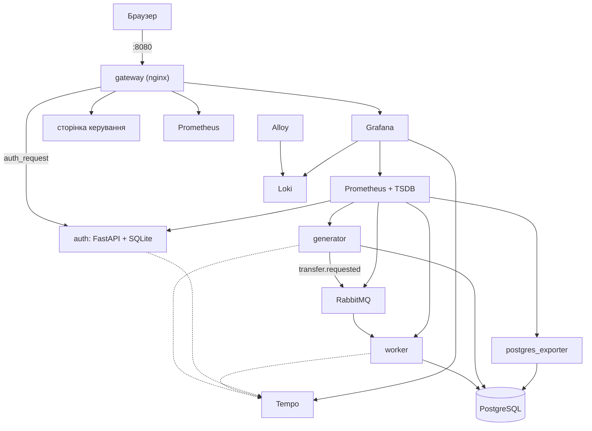

Система складається з трьох частин.

1. **Банк.** У PostgreSQL 200 рахунків, таблиця переказів і журнал проводок. Сервіс `generator` (Python) імітує клієнтів: надсилає заявки на перекази в RabbitMQ, перевіряє баланси, читає виписки, поповнює рахунки. Сервіс `worker` забирає заявки й виконує кожен переказ однією транзакцією.
2. **Спостережуваність.** Prometheus кожні 5 секунд збирає метрики PostgreSQL (`postgres_exporter`), RabbitMQ і трьох Python-сервісів та обчислює 7 правил алертів. Alloy збирає логи всіх контейнерів у Loki. Сервіси надсилають трейси в Tempo за протоколом OTLP. Grafana показує 6 дашбордів і звʼязує сигнали між собою.
3. **Доступ.** Назовні відкрито лише порт gateway (nginx). На кожен запит gateway питає сервіс `auth`, чи дійсний токен і яка роль користувача, і лише тоді пропускає запит далі.

**Шлях одного переказу.** `generator` відкриває спан `generator.transfer` і публікує повідомлення `transfer.requested` з контекстом трейсу в заголовках. RabbitMQ тримає його в черзі `transfers.requested`. Один із потоків `worker` бере повідомлення, продовжує той самий трейс спаном `worker.process_transfer` і в одній транзакції блокує обидва рахунки, записує переказ, списує, зараховує й додає дві проводки. Брак коштів відкочує транзакцію (обмеження `CHECK (balance >= 0)`), і переказ записується як `failed`. Метрики worker фіксують результат і час, лог — подію `transfer_completed` чи `transfer_failed` з тим самим `trace_id`, PostgreSQL — повільні запити, очікування блокувань і помилки.

**Модель безпеки.** Межа довіри — мережа Docker Compose. Назовні опубліковано лише `gateway`; сервіси одне одному довіряють. Паролі зберігаються як хеші bcrypt у SQLite, токен — JWT (HS256) у cookie `HttpOnly` або в заголовку `Authorization`. Gateway сам формує заголовки з іменем і роллю користувача з відповіді `auth`, а однойменні заголовки від клієнта відкидає. Grafana довіряє лише цим заголовкам (режим auth proxy) і не має власної форми входу.

## 3. Реалізація

### 3.0. СУБД у Docker-контейнері

PostgreSQL 17.11 працює в контейнері `postgres`. Схему, 200 рахунків по 10 000 і ролі створюють скрипти ініціалізації під час першого запуску. Роль `bank_app` може лише читати, додавати й оновлювати рядки; роль `bank_monitor` — читати статистику (`pg_monitor`). Сервер логує запити, довші за 200 мс, очікування блокувань і взаємні блокування; підключено `pg_stat_statements`.

Файли: `db/init/01-schema.sql`, `db/init/02-seed.sql`, `db/init/03-roles.sh`, `docker-compose.yml`.

Перевірка: `make up`, потім `docker compose exec postgres psql -U bank_admin -d bank -c "SELECT count(*) FROM accounts"` → 200.

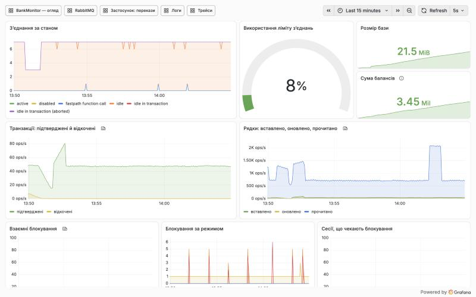

### 3.1. Генерація актуалізації даних (Python 3)

Сервіс `generator` виконує 20 операцій за секунду: перекази (70 %), перевірки балансу (20 %), виписки (8 %), поповнення (2 %). Сервіс `worker` виконує перекази в транзакціях. Інтенсивність і сценарії змінюються на сторінці керування або командою `make scenario`.

Файли: `services/generator/bank_generator/engine.py`, `services/generator/bank_generator/operations.py`, `services/worker/bank_worker/processor.py`.

Перевірка: сторінка <http://localhost:8080/control/> (вхід `admin`), панель «Перекази за статусом» на огляді.

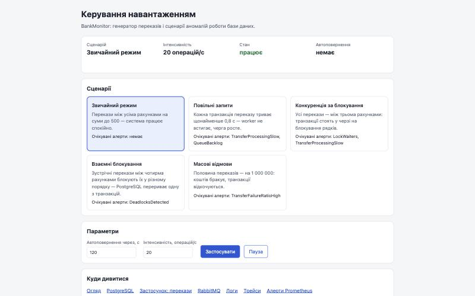

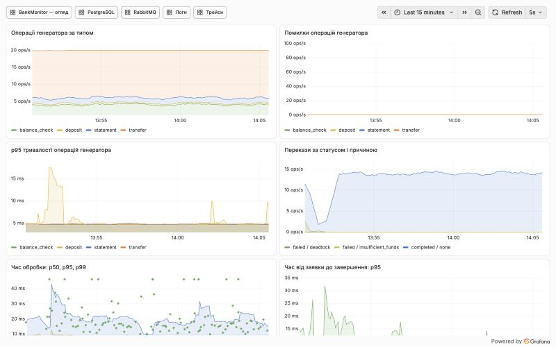

### 3.2. Збір даних Prometheus

Prometheus збирає метрики кожні 5 секунд з 10 цілей: `postgres_exporter` (статистика PostgreSQL і `pg_stat_statements`), RabbitMQ (стан черг), `generator` (операції й SQL-зонд: очікування блокувань, найдовша транзакція, сума балансів), `worker` (перекази, час обробки, повтори, помилки SQL), `auth` (входи), а також Grafana, Loki, Alloy, Tempo і сам Prometheus. Сім правил алертів описують аномалії.

Файли: `observability/prometheus/prometheus.yml`, `observability/prometheus/rules/bank.yml`, `services/worker/bank_worker/metrics.py`, `services/generator/bank_generator/metrics.py`.

Перевірка: <http://localhost:8080/prometheus/targets> — усі цілі `UP`.

```promql
sum(rate(pg_stat_database_xact_commit{datname="bank"}[1m]))
```

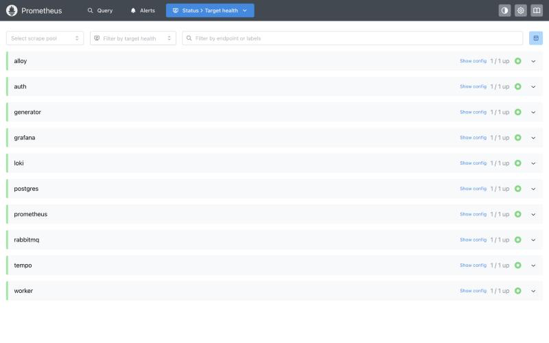

### 3.3. Збереження даних у Time Series Storage

Метрики зберігаються у вбудованій базі часових рядів Prometheus (TSDB) на томі Docker `prom_data` протягом 15 діб (`--storage.tsdb.retention.time=15d`). Дані переживають перезапуск контейнера.

Файли: `docker-compose.yml` (сервіс `prometheus`, том `prom_data`).

Перевірка: <http://localhost:8080/prometheus/api/v1/status/flags> → `storage.tsdb.retention.time: 15d`.

```promql
prometheus_tsdb_head_series
```

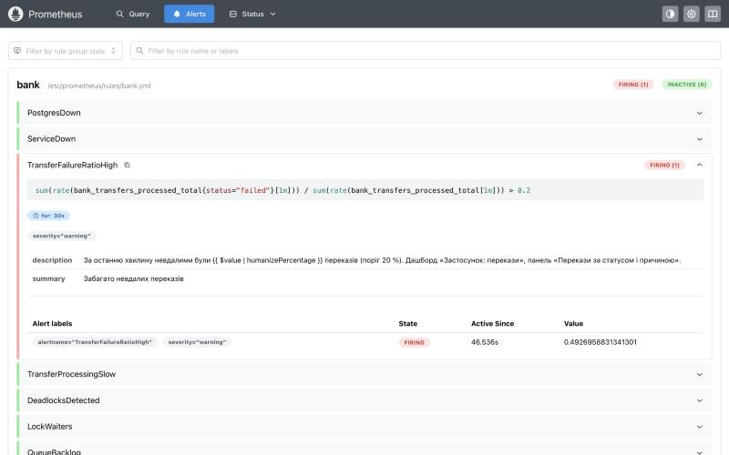

### 3.4. Відображення даних у Grafana

Шість дашбордів описано як код і завантажено автоматично (provisioning): «BankMonitor — огляд», «PostgreSQL», «Застосунок: перекази», «RabbitMQ», «Логи», «Трейси». Редагувати їх з інтерфейсу не можна, тож вигляд завжди збігається з репозиторієм.

Файли: `observability/grafana/provisioning/datasources/datasources.yml`, `observability/grafana/provisioning/dashboards/dashboards.yml`, `observability/grafana/dashboards/`.

Перевірка: <http://localhost:8080/grafana/> після входу відкриває огляд.

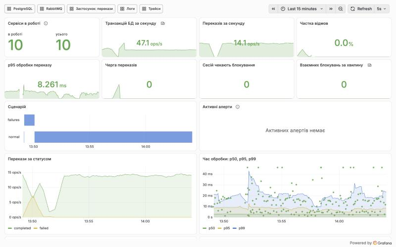

### 3.5. Дослідження логів (Grafana Loki)

Сервіси пишуть логи як JSON (подія, рівень, поля, `trace_id`). Alloy читає логи всіх контейнерів проєкту через Docker і надсилає в Loki з мітками `service`, `container`, `level`. Дашборд «Логи» показує обсяг логів, помилки, потік рядків із пошуком, повільні запити й блокування PostgreSQL, невдалі входи, журнал gateway.

Файли: `observability/loki/loki.yml`, `observability/alloy/config.alloy`, `services/common/bankmon_common/logging.py`, `observability/grafana/dashboards/bank-logs.json`.

Перевірка: дашборд «Логи», або Explore → Loki:

```logql
{service="worker"} | json | event="transfer_completed"
```

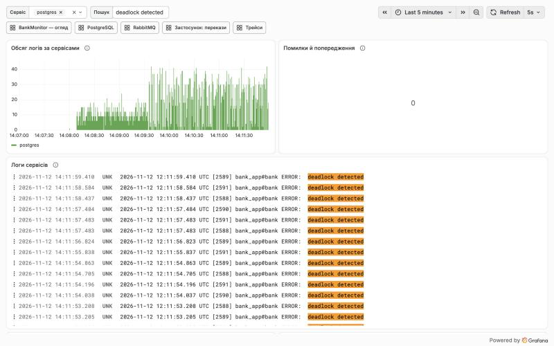

### 3.6. Дослідження трейсів (Grafana Tempo)

Python-сервіси інструментовано OpenTelemetry: автоматично трасуються запити до PostgreSQL (psycopg), публікація й споживання повідомлень (pika) і HTTP-запити (FastAPI); вручну — операції генератора й обробка переказу. Контекст трейсу передається в заголовках повідомлення RabbitMQ, тому переказ видно одним трейсом від генератора до SQL-запитів worker. Grafana переходить від точки на графіку часу обробки (exemplar) до трейсу, від трейсу — до логів, від рядка логу — до трейсу.

Файли: `services/common/bankmon_common/tracing.py`, `services/worker/bank_worker/consumer.py`, `observability/tempo/tempo.yml`, `observability/grafana/dashboards/bank-traces.json`.

Перевірка: дашборд «Трейси», або Explore → Tempo:

```traceql
{ resource.service.name = "worker" && name = "worker.process_transfer" }
```

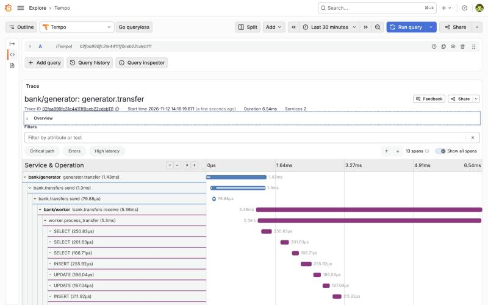

### 3.7. Авторизація (Python 3 + SQLite)

Сервіс `auth` (FastAPI) зберігає користувачів у SQLite з паролями bcrypt, видає JWT і відповідає gateway, чи дійсний токен і яка роль. Ролі: `admin` (усе) і `viewer` (лише Grafana). Невірний пароль і невідомий логін дають однакову відповідь і однаковий час; токени з чужим ключем, зміненим підписом, `alg: none` чи простроченим терміном відхиляються; перенаправлення після входу можливе лише на локальний шлях.

Файли: `services/auth/bank_auth/security.py`, `services/auth/bank_auth/users.py`, `services/auth/bank_auth/api.py`, `gateway/nginx.conf`.

Перевірка: <http://localhost:8080/control/> без входу → форма входу; `viewer` на `/control/` → 403.

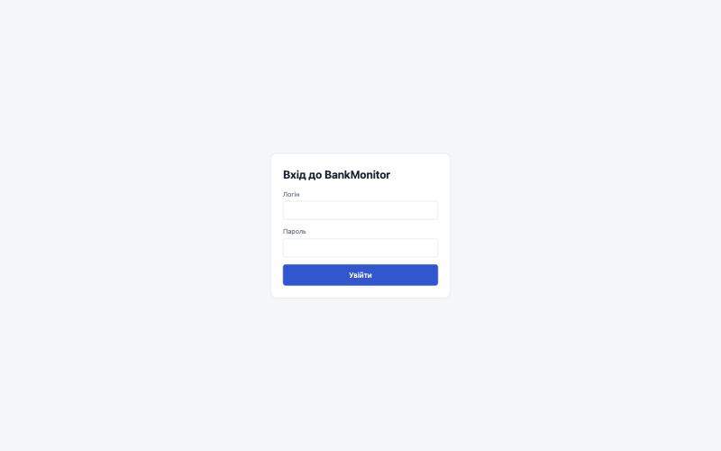

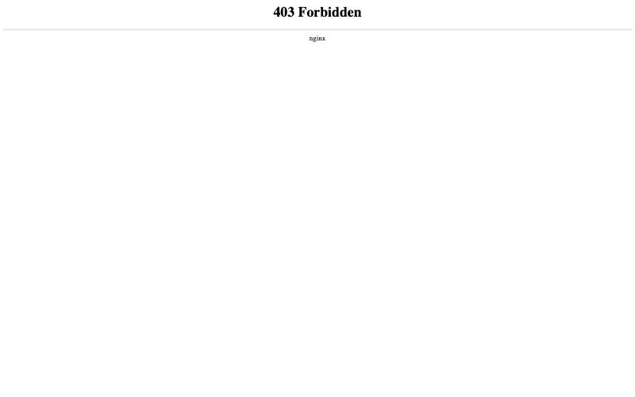

### 3.8. Контейнеризація Docker

Уся система — один `docker-compose.yml`: 12 сервісів, один одноразовий контейнер налаштування Grafana і контейнер тестів. Три сервіси на Python мають власні образи на базі `python:3.13.18-slim` і працюють не від root. Порядок запуску задано залежностями з перевірками готовності, тому `make up` повертається, коли все готове.

Файли: `docker-compose.yml`, `docker-compose.dev.yml`, `services/worker/Dockerfile`, `Makefile`.

Перевірка: `make up`, потім `make ps`.

```promql
count(up == 1)
```

### 3.9. Обмін повідомленнями (RabbitMQ)

`generator` публікує заявки `TransferRequested` (JSON) в обмінник `bank.transfers` з підтвердженням доставки; черга `transfers.requested` довговічна. `worker` бере по одному повідомленню на потік і підтверджує його лише після запису в базу. Невалідні повідомлення йдуть у чергу мертвих листів `transfers.dead`. Якщо worker зупинити, заявки накопичуються в черзі й обробляються після запуску без втрат.

Файли: `services/common/bankmon_common/amqp.py`, `services/common/bankmon_common/messages.py`, `services/worker/bank_worker/consumer.py`.

Перевірка: дашборд «RabbitMQ»; `docker compose stop worker` — черга росте, `docker compose start worker` — спадає.

```promql
rabbitmq_queue_messages_ready{queue="transfers.requested"}
```

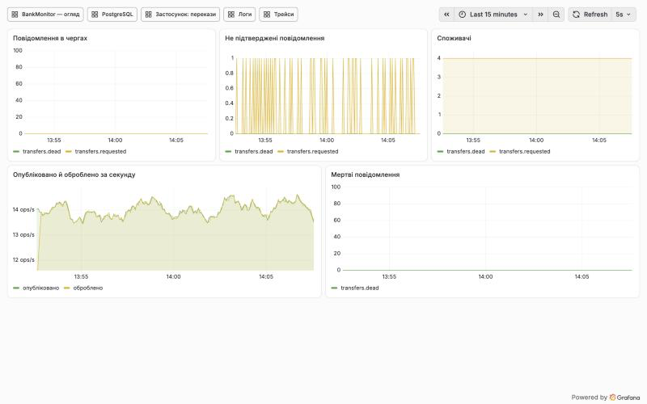

## 4. Дослідження аномалій

### 4.1. Повільні запити

**Що вмикається:** кожна транзакція переказу після блокування рахунків чекає 0,8 с (`pg_sleep`).

**Метрики:** 95-й перцентиль часу обробки переказу зростає з кількох мілісекунд до понад 0,8 с; worker обробляє ≈5 переказів за секунду при 14 вхідних, черга росте. Спрацьовують `TransferProcessingSlow` і `QueueBacklog`.

```promql
histogram_quantile(0.95, sum by (le) (rate(bank_transfer_processing_seconds_bucket[1m])))
```

**Логи:** PostgreSQL записує кожен запит, довший за 200 мс.

```logql
{service="postgres"} |= "duration:" |= "pg_sleep"
```

**Трейси:** у трейсі переказу SQL-спан `pg_sleep` займає майже весь час спана `worker.process_transfer`.

```traceql
{ resource.service.name = "worker" && name = "worker.process_transfer" && duration > 700ms }
```

**Висновок:** повільна транзакція тримає рахунки заблокованими, і пропускна здатність обробника падає нижче за вхідний потік — накопичується черга. За трейсом видно, який саме запит повільний.

### 4.2. Конкуренція за блокування

**Що вмикається:** усі перекази — між трьома рахунками, кожна транзакція тримає блокування 0,4 с.

**Метрики:** SQL-зонд бачить сесії, що чекають на блокування, і вік найстаршої транзакції; спрацьовують `LockWaiters` і `TransferProcessingSlow`.

```promql
max_over_time(bank_db_lock_waiters[1m])
```

**Логи:** PostgreSQL пише про очікування блокування довше за `deadlock_timeout` (0,5 с).

```logql
{service="postgres"} |= "still waiting for"
```

**Трейси:** у спанах `worker.process_transfer` більшу частину часу займає запит `SELECT … FOR NO KEY UPDATE` — очікування блокування рядка.

```traceql
{ resource.service.name = "worker" && name = "worker.process_transfer" && duration > 300ms }
```

**Висновок:** коли багато транзакцій змагаються за ті самі рядки, вони виконуються по черзі, хоча в базі вільні зʼєднання. Це видно як ріст очікувань блокувань при незмінній кількості транзакцій.

### 4.3. Взаємні блокування

**Що вмикається:** перекази між чотирма рахунками блокують відправника першим, а між блокуваннями — пауза 0,15 с. Зустрічні перекази (A → B і B → A) чекають один на одного.

**Метрики:** лічильник `deadlocks` у статистиці бази й лічильник повторів worker зростають; спрацьовує `DeadlocksDetected`.

```promql
increase(pg_stat_database_deadlocks{datname="bank"}[1m])
```

**Логи:** PostgreSQL описує цикл очікування, worker — повтор.

```logql
{service="postgres"} |= "deadlock detected"
```

```logql
{service="worker"} | json | event="deadlock_retry"
```

**Трейси:** спан `worker.process_transfer` має подію `deadlock_retry` і атрибут `bank.attempts` більший за 1.

```traceql
{ span.bank.attempts > 1 }
```

**Висновок:** PostgreSQL сам знаходить взаємне блокування й перериває одну з транзакцій; застосунок має бути готовим повторити її. Причина — різний порядок блокування рахунків: у звичайному режимі worker блокує їх за зростанням номера, і взаємних блокувань немає.

### 4.4. Масові відмови

**Що вмикається:** половина переказів — на 1 000 000, якого немає на жодному рахунку.

**Метрики:** частка невдалих переказів наближається до 50 %, зростає кількість відкочених транзакцій; спрацьовує `TransferFailureRatioHigh`.

```promql
sum(rate(bank_transfers_processed_total{status="failed"}[1m])) / sum(rate(bank_transfers_processed_total[1m]))
```

**Логи:** PostgreSQL фіксує порушення обмеження, worker — невдалий переказ із причиною.

```logql
{service="worker"} | json | event="transfer_failed" | reason="insufficient_funds"
```

**Трейси:** у трейсі невдалого переказу SQL-спан `UPDATE accounts …` має статус помилки, а `worker.process_transfer` — атрибут `bank.status = "failed"`.

```traceql
{ span.bank.status = "failed" && span.bank.fail_reason = "insufficient_funds" }
```

**Висновок:** перевірку балансу виконує сама база (`CHECK`), тому кожна відмова видна і в статистиці PostgreSQL (відкати), і в лозі бази, і в метриках застосунку. Від рядка логу можна перейти до трейсу конкретного переказу за `trace_id`.

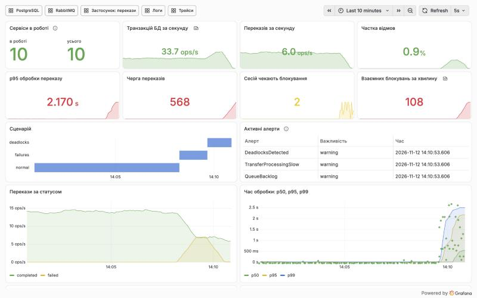

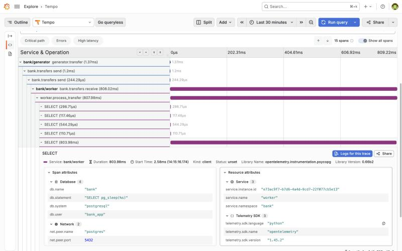

## 5. Тестування

| Рівень | Що перевіряє | Кількість | Команда |
|---|---|---|---|
| Статика | стиль і типові помилки коду (ruff) | усі файли Python | `make lint` |
| Юніт | логіку без стенда | 153 | `make unit` |
| Наскрізні | живий стенд: БД, черга, метрики, алерти, логи, трейси, доступ, документи | 275 | `make e2e` |
| Збій | зупинка й запуск worker | 3 фази | `make outage-test` |
| Повний прогін | усе з чистого стану | — | `make verify` |

Підсумок `make verify`:

```text
Step                       Time    Result
make clean                     16s   OK
check images                  112s   OK
make up                        14s   OK
make check-ports                0s   OK
make lint                       2s   OK
make unit                      10s   OK
make e2e                     1034s   OK
make outage-test               84s   OK
JSON logs                       1s   OK
final state                     2s   OK
Total: 1275s
VERIFY OK
```

## 6. Висновки

Побудовано систему, у якій кожна аномалія роботи бази даних видна трьома способами: як зміна метрик і алерт у Prometheus, як рядки в логах Loki і як структура трейсу в Tempo, а Grafana дає переходити між ними. Генератор на Python створює навантаження й відтворює чотири типові проблеми: повільні запити, конкуренцію за блокування, взаємні блокування й масові відмови. Обмін через RabbitMQ розвʼязує генератор і обробник: зупинка обробника не губить заявок. Доступ до всього має лише користувач, що увійшов через власний сервер авторизації, з розподілом ролей. Уся система описана як код (Docker Compose, конфігурації, дашборди) і перевіряється автоматично однією командою.

## 7. Додаток

### 7.1. Схема бази даних

| Таблиця | Колонки |
|---|---|
| `accounts` | `id`, `owner_name`, `balance` (≥ 0), `created_at`, `updated_at` |
| `transfers` | `id` (uuid), `from_account`, `to_account`, `amount` (> 0), `status` (`completed`/`failed`), `fail_reason`, `attempts`, `requested_at`, `processed_at` |
| `ledger_entries` | `id`, `account_id`, `transfer_id`, `kind` (`opening`/`transfer_out`/`transfer_in`/`deposit`), `delta`, `created_at` |
| `scenario_state` | `scenario`, `lock_order`, `lock_gap_ms`, `sleep_ms`, `updated_at` — що застосовує worker |

### 7.2. Власні метрики

| Метрика | Що означає |
|---|---|
| `bank_transfers_processed_total` | перекази за статусом і причиною |
| `bank_transfer_processing_seconds` | час обробки переказу (з exemplar `trace_id`) |
| `bank_transfer_e2e_seconds` | час від заявки до завершення |
| `bank_transfer_retries_total` | повтори після взаємного блокування |
| `bank_worker_db_errors_total` | помилки PostgreSQL за кодом SQLSTATE |
| `bank_worker_messages_dead_lettered_total`, `bank_worker_duplicates_total`, `bank_worker_in_flight` | відхилені, повторні й поточні повідомлення |
| `bank_generator_operations_total`, `bank_generator_operation_duration_seconds` | операції генератора |
| `bank_scenario_active`, `bank_generator_target_rate`, `bank_generator_running` | активний сценарій і режим |
| `bank_db_lock_waiters`, `bank_db_longest_transaction_seconds`, `bank_db_accounts_total_balance`, `bank_db_probe_up` | SQL-зонд стану бази |
| `bank_auth_logins_total`, `bank_auth_verify_total` | входи й перевірки доступу |
| `bank_http_requests_total`, `bank_http_request_duration_seconds` | HTTP-запити сервісів |

### 7.3. Правила алертів

| Алерт | Умова | Важливість |
|---|---|---|
| `PostgresDown` | `pg_up == 0` понад 30 с | critical |
| `ServiceDown` | ціль Prometheus не відповідає понад 1 хв | critical |
| `TransferFailureRatioHigh` | частка невдалих переказів за хвилину > 20 % | warning |
| `TransferProcessingSlow` | p95 часу обробки > 0,5 с | warning |
| `DeadlocksDetected` | за хвилину було взаємне блокування | warning |
| `LockWaiters` | сесії чекають на блокування понад 30 с | warning |
| `QueueBacklog` | у черзі понад 200 повідомлень понад 30 с | warning |
