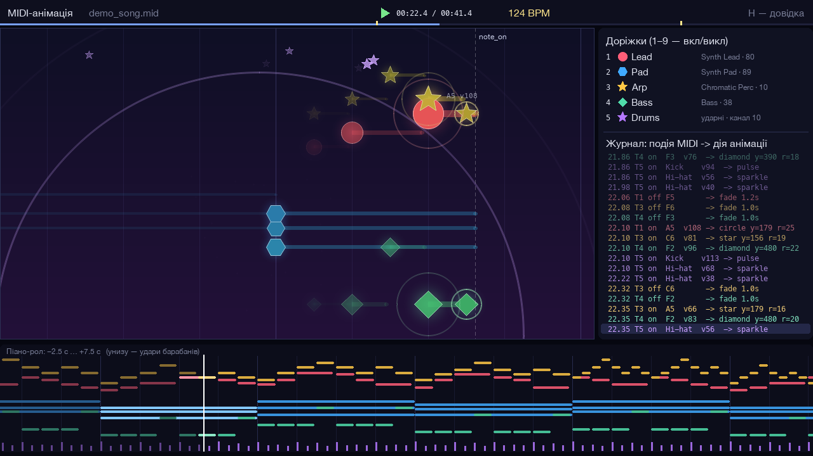
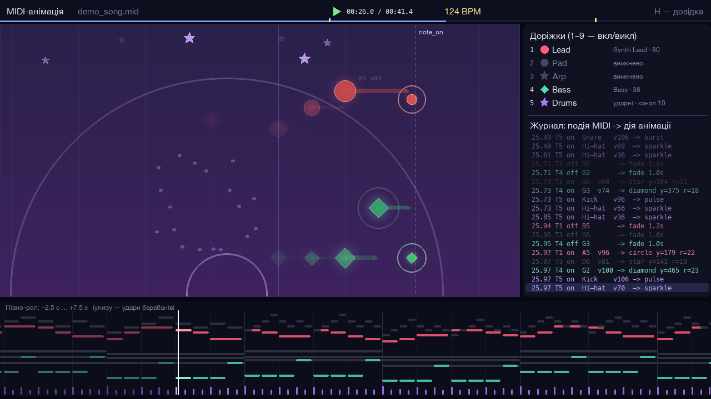
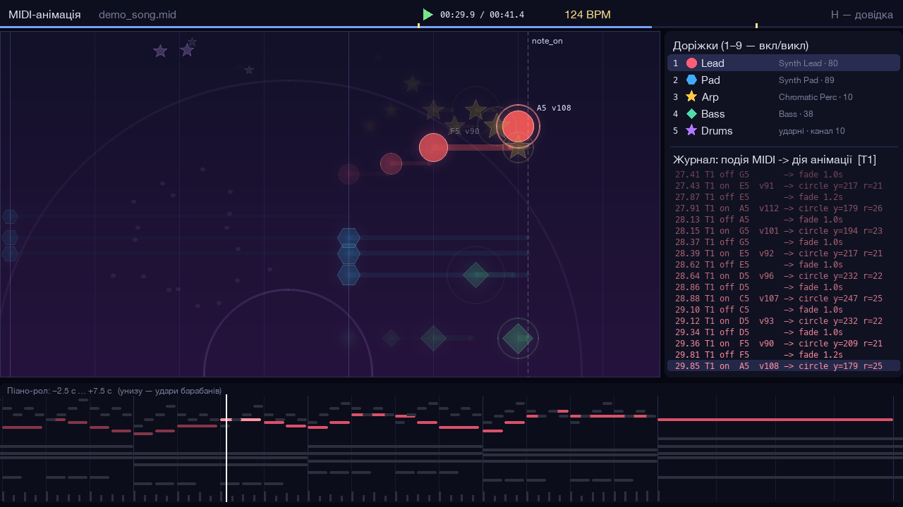
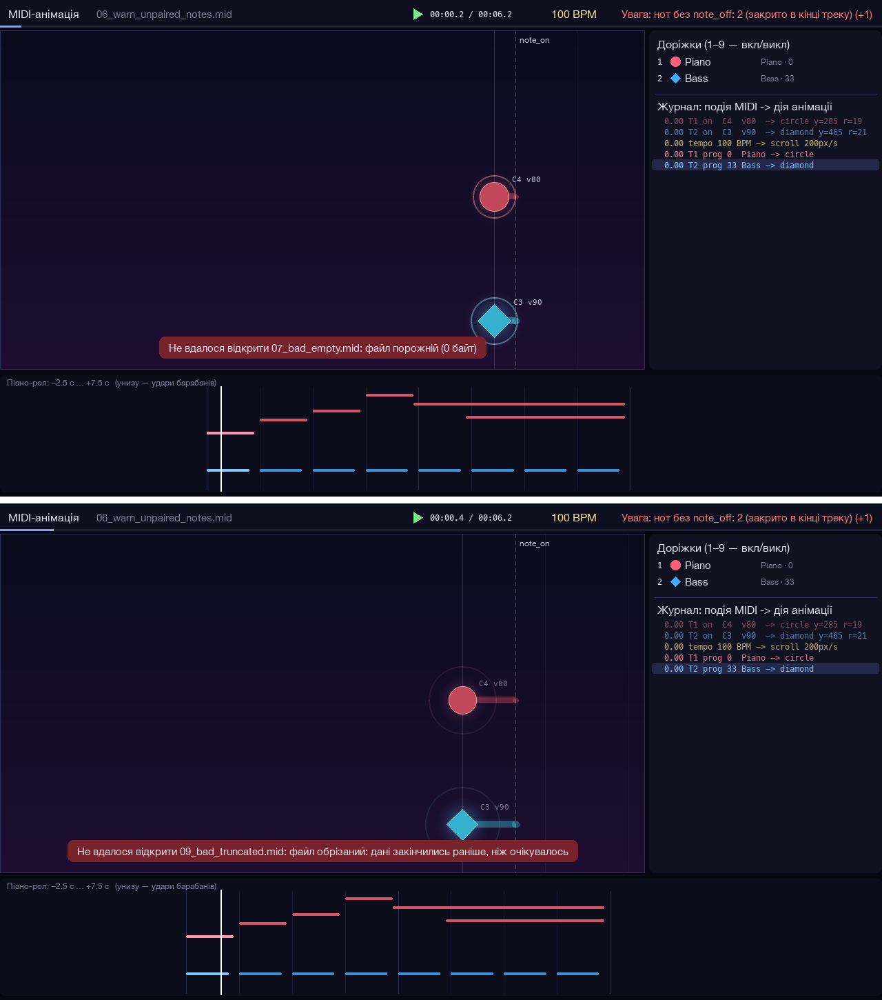

# ЛР №2, варіант 3 — MIDI-анімація

Python-програма, яка «малює» MIDI-файл: під час відтворення кожна нота з'являється на сцені як фігура, і її вигляд залежить від того, що записано у файлі, — висоти, сили натискання, інструмента, тривалості, темпу. Звук генерує власний синтезатор, тому картинка й музика йдуть синхронно.

**Звіт:** [Звіт_ЛР2_Шевнюк.pdf](Звіт_ЛР2_Шевнюк.pdf). **Демо-відео:** [demo/demo.mp4](demo/demo.mp4).



*Головне вікно на 22-й секунді demo_song.mid. Ліворуч — сцена з фігурами нот, праворуч — легенда доріжок і під нею журнал подій, унизу — піано-рол.*

## Як запустити

Потрібен Python 3.10 або новіший. На Python 3.14 стоїть `pygame-ce` замість `pygame` (у коді нічого не міняється, імпорт той самий).

```bash
python3 -m venv .venv && source .venv/bin/activate   # або спільне ../.venv
pip install -r requirements.txt

python app.py                        # відкриється midi/demo_song.mid
python app.py midi/mapping_test.mid  # файл, на якому правила відображення видно найкраще
python app.py мій_файл.mid           # свій MIDI (для умови лаби — від двох доріжок)
python -m unittest discover -s tests # 32 автоматичні тести
```

Під час роботи інший файл відкривається перетягуванням у вікно або клавішами N / P (наступний / попередній файл тієї ж папки).

Клавіші: **пробіл** — пауза, **R** — на початок, **← →** — ±5 с, **1–9** — сховати доріжку разом з її звуком, **Tab** — фокус на одній доріжці, **L** — підписи нот, **H** — довідка, **S** — скріншот, **Esc** — вихід.

Ось що буде, якщо натиснути 2 і 3. Доріжки Pad і Arp зникають і зі сцени, і зі звуку, а в легенді та піано-ролі стають сірими:



А це фокус на доріжці Lead (клавіша Tab). Решта доріжок притушена, журнал показує тільки події Lead, а біля її нот видно висоту й velocity.



## Що бачить глядач

Сцена рухається справа наліво зі швидкістю, яка залежить від темпу (2 пікселі за секунду на кожен BPM). Нова нота виникає на пунктирній лінії «note_on»:

- чим вища нота — тим вище фігура; відтінок кольору теж трохи зсувається з висотою;
- чим сильніше натиснуто (velocity) — тим більша й яскравіша фігура;
- форма показує родину інструмента: коло — фортепіано, ромб — бас, шестикутник — струнні й пади, зірка — перкусія…;
- колір — номер доріжки (такий самий у легенді та на піано-ролі внизу);
- поки нота звучить, за фігурою тягнеться «хвіст», а після note_off вона згасає тим довше, чим довшою була нота;
- барабани (канал 10) не мають фігур, натомість дають ефекти: kick — пульсацію фону, snare — розліт частинок, hi-hat — іскри, crash — спалах.

Праворуч іде журнал, який розшифровує кожну подію: наприклад, `22.10 T1 on A5 v108 -> circle y=179 r=25` означає, що доріжка 1 на 22,10 с взяла A5 з velocity 108 і на сцені з'явилося коло на висоті 179 радіусом 25. Усі формули зібрано в одному файлі `mapping.py`, тож правило легко знайти й показати на захисті.

## Як програма поводиться з поганими файлами

Скрипт `tools/make_test_inputs.py` створює в `midi/samples/` дванадцять файлів трьох видів (їх зручно гортати клавішею N):

- `01–03 ok_*` — правильні, але незвичні: MIDI типу 0 з трьома каналами в одному треку, кілька змін темпу, крайні значення висоти й velocity;
- `04–06 warn_*` — відкриваються з попередженням: лише одна доріжка, жодної ноти, ноти без пари note_on/note_off;
- `07–12 bad_*` — не відкриваються: порожній файл, текст із розширенням .mid, обрізаний файл, нульовий ticks_per_beat, зіпсований байт даних, `.txt`.

У вікні помилка з'являється червоним повідомленням, а попередня пісня грає далі; у режимі без вікна друкується причина і повертається код 1. На скріншоті грає `06_warn_unpaired_notes.mid`, попередження про ноти без note_off видно у верхньому рядку. Поки він грає, я пробую відкрити зламані файли: на верхньому кадрі порожній, на нижньому обрізаний.



 Окремо перевірено (і покрито тестами) темп 0, «безкінечні» файли з пошкодженими часовими позначками, SMPTE-час, папку замість файлу і хибні параметри командного рядка.

## Відео й кадри без вікна

```bash
python app.py midi/demo_song.mid --export demo/demo.mp4           # 1280×720, H.264 + AAC
python app.py midi/demo_song.mid --screenshot 5,12.5,30 --outdir shots
python app.py midi/demo_song.mid --export lead.mp4 --focus 1 --start 19 --end 35
```

Також є `--size 1920x1080`, `--fps 60`, `--hide 2,3`, `--no-labels`, `--no-audio`.

## Код

- `app.py` — запуск, вікно, клавіатура, звук, експорт у відео;
- `midi_loader.py` — розбір MIDI: тіки в секунди з урахуванням змін темпу, ноти, доріжки, перевірки;
- `mapping.py` — правила «MIDI → анімація»;
- `scene.py` — малює кадр для будь-якого моменту часу t (тому пауза й перемотування прості);
- `synth.py` — синтезатор (адитивний синтез з обвідною ADSR, окремо ударні);
- `make_demo_midi.py`, `tools/` — генератори демо-файлів, тестових входів і ілюстрацій для звіту;
- `tests/` — тести, `demo/demo.mp4` — готове демо-відео.

Залежності: pygame-ce, mido, numpy, imageio-ffmpeg (для експорту), Pillow (лише для ілюстрацій звіту).
