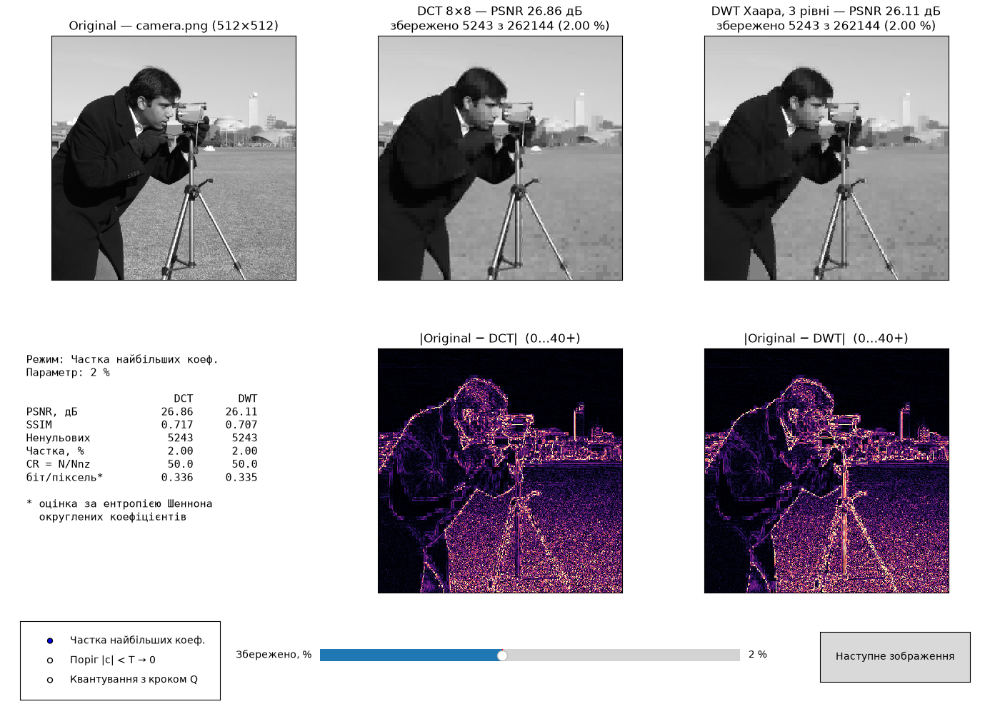
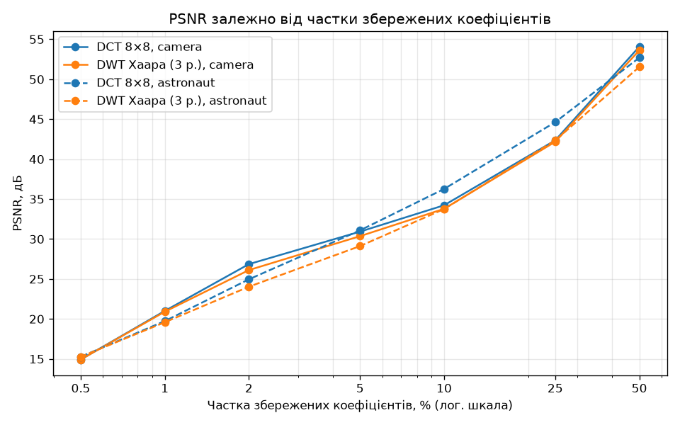
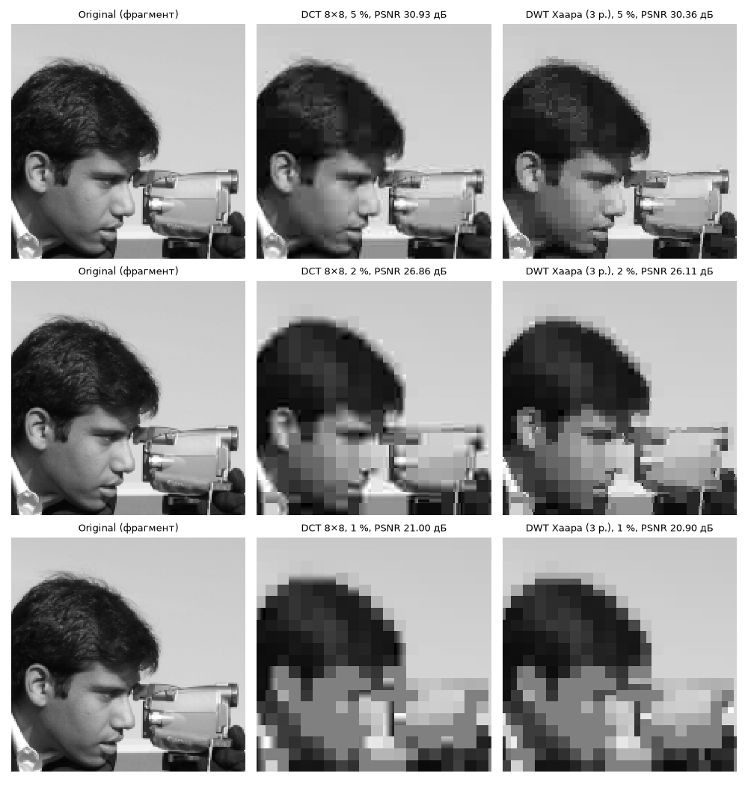
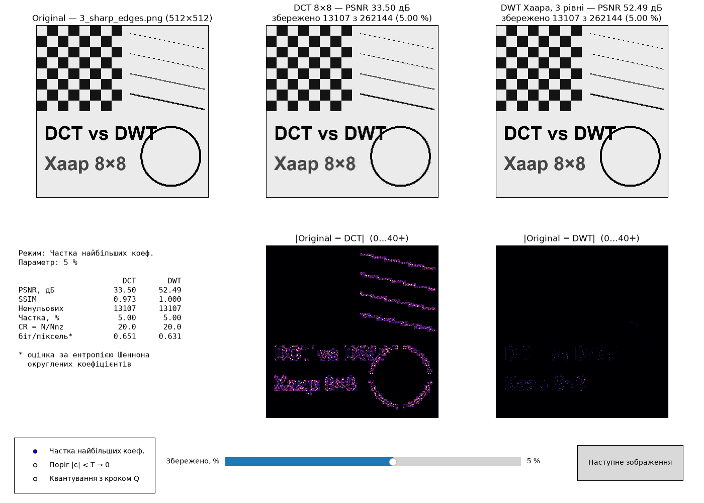

# ЛР №3 — стиснення зображень: DCT проти вейвлета Хаара

Програма бере сіре зображення, стискає його двома способами — DCT по блоках 8×8 і багаторівневим перетворенням Хаара — і показує три картинки поряд (Original | DCT | DWT) з PSNR над кожною. Рівень стиснення крутиться повзунком, тож видно, як якість падає наживо. Обидва перетворення написані самостійно на NumPy.

**Звіт:** [Звіт_ЛР3_Шевнюк.pdf](Звіт_ЛР3_Шевнюк.pdf).

## Як запустити

```bash
python3 -m venv .venv && source .venv/bin/activate   # або спільне ../.venv
pip install -r requirements.txt

python app.py                          # усі зображення з images/ (першим — camera)
python app.py фото.jpg                 # своє зображення; кольорове стане сірим
python app.py --mode quant --level 25  # інший режим: keep (за замовчуванням) | threshold | quant
python app.py --levels 5               # глибина DWT (за замовчуванням 3 рівні)
python experiments.py                  # перерахувати всі таблиці й графіки звіту
python -m unittest -v                  # 20 тестів
```

У вікні під кожною картинкою — карта помилки (де саме відновлене зображення відрізняється від оригіналу), внизу вікна — повзунок і перемикач режиму, кнопка «Наступне зображення» гортає файли. Зображення будь-якого розміру підходять: краї доповнюються до кратного 8 (для DWT — до кратного 2^рівнів) і після відновлення обрізаються.



*Так виглядає вікно, коли від camera лишається 2 % коефіцієнтів: DCT дає 26,86 дБ, DWT — 26,11 дБ. Ліворуч унизу зведено числа (PSNR, SSIM, ступінь стиснення, біт на піксель). Під кожним методом — карта його помилки: що яскравіше, то більше відрізняється піксель.*

## Як це влаштовано

**DCT (`dct.py`).** Будується матриця C розміром 8×8, де k-й рядок — косинус k-ї частоти; вона ортонормована, тому обернена матриця — це просто Cᵀ. Від пікселів віднімається 128, зображення ріжеться на блоки, і кожен блок X перетворюється як Y = C·X·Cᵀ (назад — X = Cᵀ·Y·C). Усі блоки обробляються разом одним множенням тривимірних масивів, без циклу по блоках.

**DWT Хаара (`dwt.py`).** Сусідні пікселі a і b замінюються на (a + b)/√2 і (a − b)/√2 — «середнє» і «різницю». Це робиться спочатку по рядках, потім по стовпцях, і зображення розпадається на зменшену копію LL та три підсмуги деталей; далі те саме повторюється для LL (за замовчуванням тричі).

**Як зменшується кількість коефіцієнтів (`compressor.py`).** Є три режими: залишити задану частку найбільших за модулем коефіцієнтів (keep — у ньому обидва методи мають рівно однаковий «бюджет»), обнулити все менше за поріг T (threshold) або квантувати з кроком Q (quant). Після оберненого перетворення значення округлюються до 0…255.

**Якість (`metrics.py`).** PSNR = 10·log10(255² / MSE), де MSE — середній квадрат різниці пікселів; для однакових зображень PSNR нескінченний. Окремо оцінено, скільки біт насправді знадобилось би (ентропія коефіцієнтів), бо «5 % коефіцієнтів» — ще не файл у 20 разів менший.

Готових `scipy.fft`, `pywt` чи `cv2.dct` у програмі немає; SciPy використано тільки в одному тесті, щоб звірити моє DCT з еталонним.

## Що вийшло

Головний експеримент — режим keep на фото camera й astronaut (512×512), DWT з трьома рівнями. Різниця = PSNR DCT − PSNR DWT:

| Зображення | Залишено коефіцієнтів | DCT, дБ | DWT, дБ | Різниця, дБ |
|---|---|---|---|---|
| camera | 10 % | 34,23 | 33,78 | +0,45 |
| camera | 5 % | 30,93 | 30,36 | +0,57 |
| camera | 1 % | 21,00 | 20,90 | +0,10 |
| astronaut | 10 % | 36,27 | 33,75 | +2,52 |
| astronaut | 5 % | 31,09 | 29,12 | +1,97 |
| astronaut | 1 % | 19,73 | 19,58 | +0,15 |
| 3_sharp_edges (синтетичне) | 5 % | 33,5 | 52,5 | −19,0 |

На графіку той самий режим keep від 0,5 до 50 %. Сині лінії (DCT) майже всюди трохи вищі за помаранчеві (DWT), а при 0,5–1 % вони практично зливаються:



Отже, на фотографіях DCT трохи кращий, а при 1 % методи зрівнюються. Якщо дати Хаару 4–5 рівнів, при дуже сильному стисненні (0,5–2 %) він уже обганяє DCT. На око помилки в них різні. DCT розсипається на блоки 8×8 і дає дзвін біля контурів, а в Хаара краї стають ступінчастими і з'являються прямокутні плями. Найкраще це видно на збільшеному обличчі з camera при 5, 2 і 1 %:



На штучній картинці з однотонними площинами й різкими межами Хаар виграє з великим відривом, бо його базисні функції самі по собі «сходинки». При 5 % коефіцієнтів DWT дає 52,5 дБ, а DCT лише 33,5 дБ:



Усі таблиці (`results/`), графіки (`report_assets/`) і розбір — у звіті.

## Файли

- `app.py` — інтерактивне порівняння;
- `dct.py`, `dwt.py` — власні перетворення;
- `compressor.py` — режими відкидання коефіцієнтів і повний цикл стиснення (назва не `compression.py`, бо в Python 3.14 так називається стандартний пакет);
- `metrics.py` — MSE, PSNR, SSIM, ентропійна оцінка;
- `experiments.py` — експерименти для звіту; `prepare_images.py` — підготовка тестових зображень;
- `images/` — camera і astronaut; `images/extra/` — кадр з мого відео до ЛР1, кольорове фото, різкі краї, плавний градієнт;
- `tests/` — 20 тестів: DCT звіряється з формулою за означенням і з SciPy, Хаар — з прикладом, порахованим на папері, перевіряється, що без відкидання коефіцієнтів зображення відновлюється без похибки, а також режими стиснення й PSNR.
